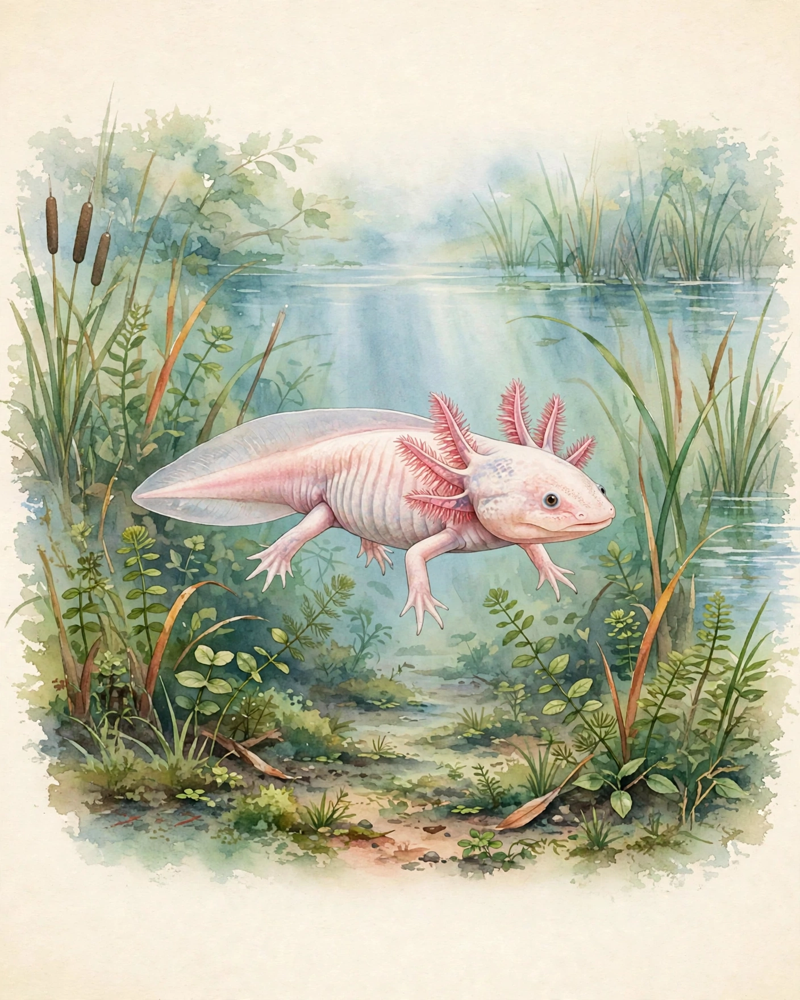
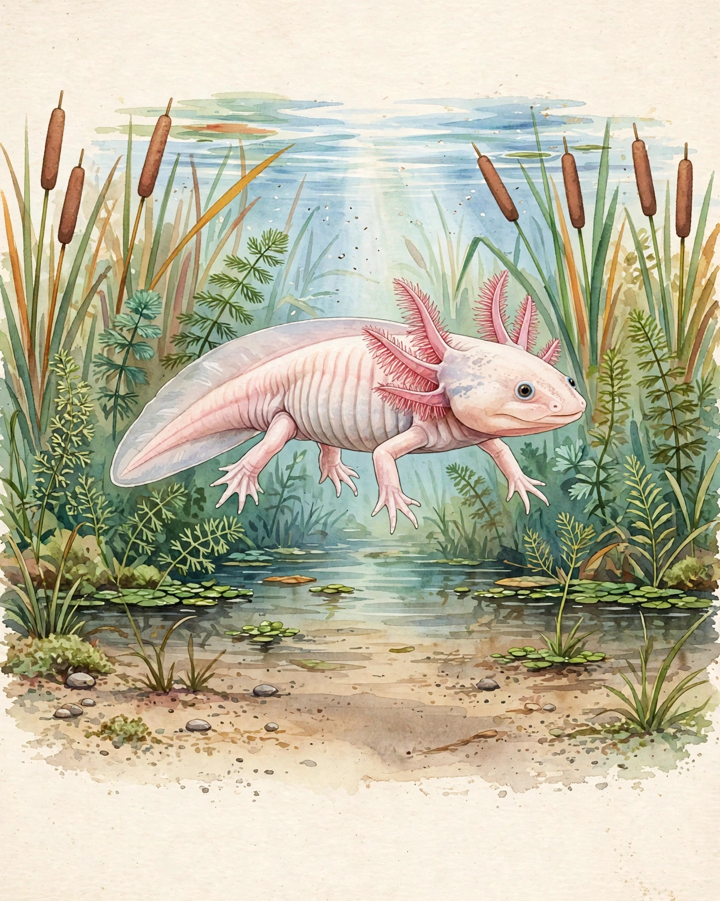
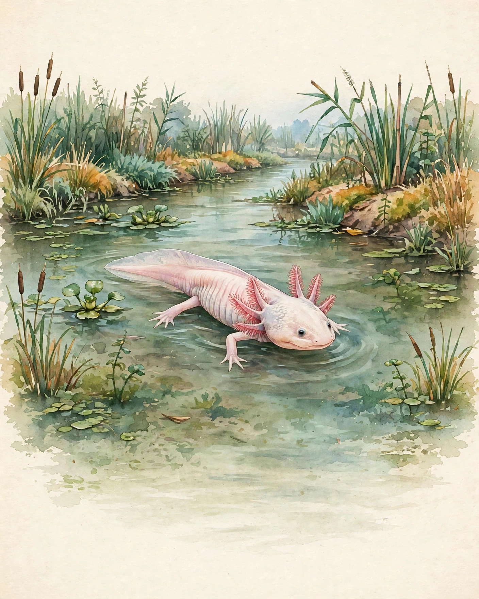
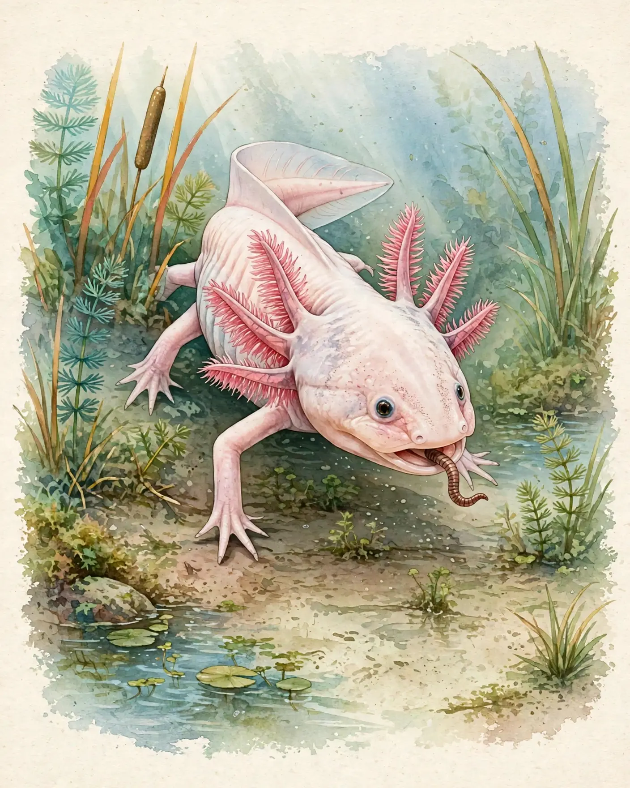
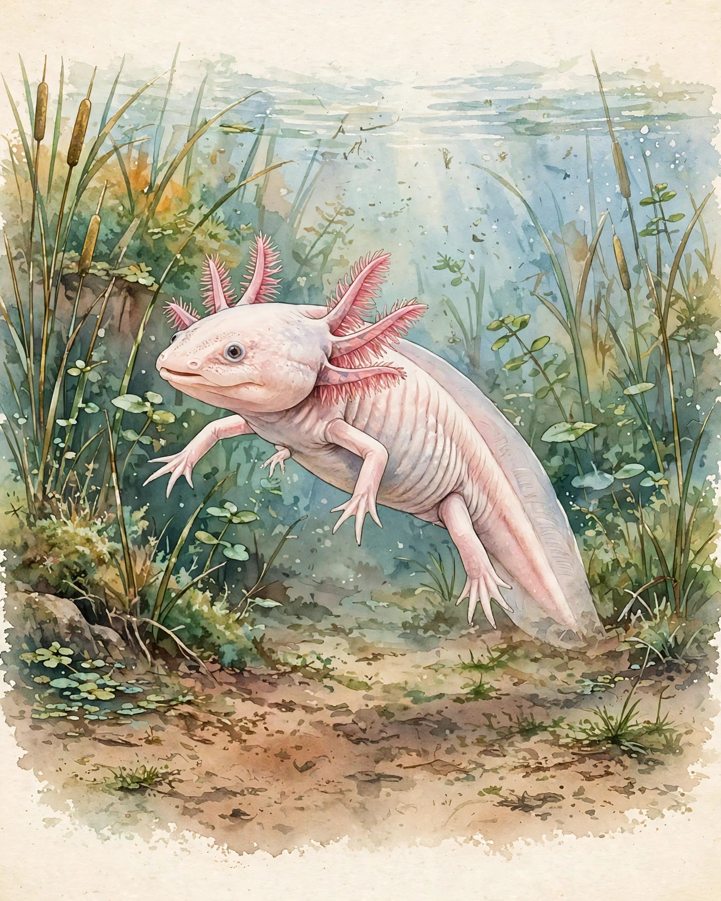
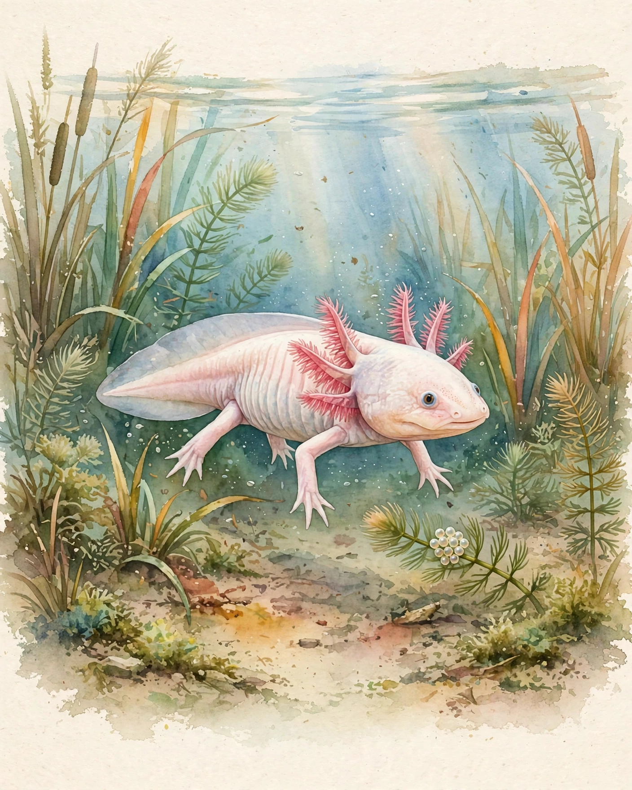
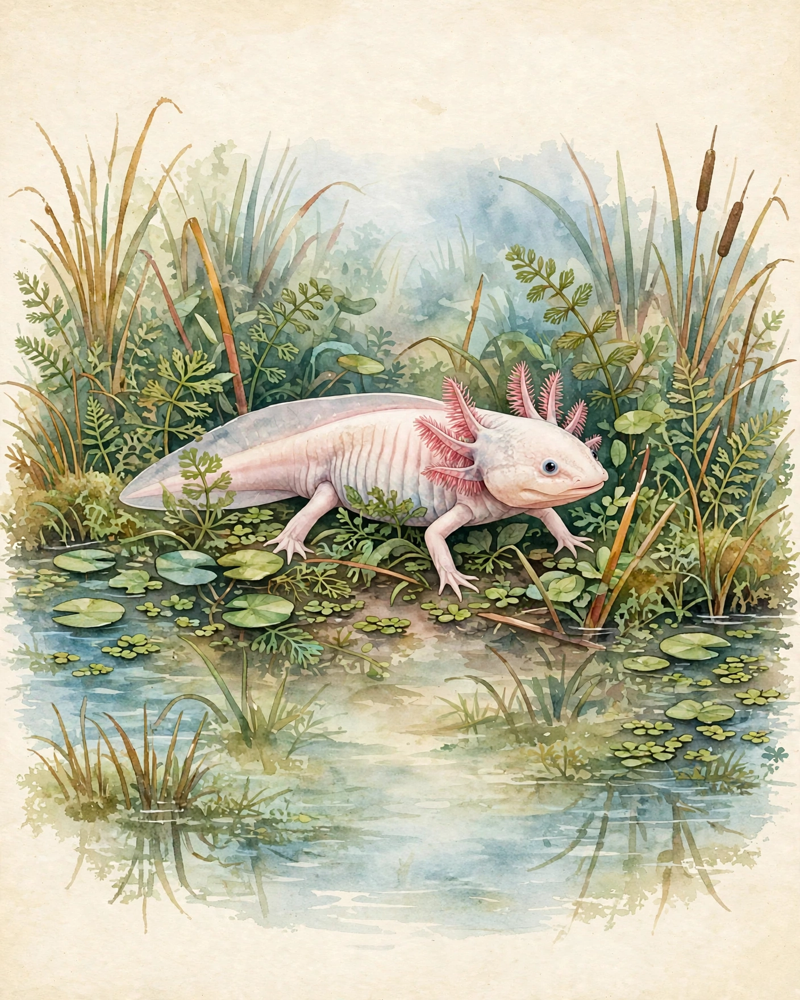

# Axolotl Si Salamander Ajaib

Siap bertemu axolotl, salamander tersenyum yang bisa menumbuhkan lagi bagian tubuhnya?

_Topik: Axolotl · Gaya gambar: cat-air_

## 1. Kenalan dengan Axolotl

Ini axolotl, salamander air yang nama ilmiahnya Ambystoma mexicanum. Salamander termasuk amfibi, yaitu hewan yang hidupnya berhubungan dengan air, tetapi axolotl istimewa karena biasanya ia tetap tinggal di air sampai dewasa dan tidak berubah menjadi hewan darat seperti kebanyakan salamander lain. Ia bernapas dengan insang luar, alat bernapas di luar kepala yang mengambil oksigen dari air, dan sesekali ia naik ke permukaan untuk menghirup udara dengan paru-parunya. Tubuhnya dapat tumbuh sampai kira-kira 30 sentimeter, sepanjang penggaris, jadi di mana ya rumah asli hewan istimewa ini?

> **Tahukah Kamu?** Axolotl tidak punya kelopak mata, jadi ia tidak bisa berkedip sama sekali dan matanya selalu terbuka!

## 2. Rumah di Kanal Xochimilco

Rumah axolotl ada di kanal-kanal Xochimilco, dekat Kota Meksiko. Air di kanal itu dangkal, sejuk, dan keruh, dengan dasar lumpur yang lembut di bawahnya. Di sepanjang tepinya, tanaman air dan alang-alang tumbuh lebat dan menjadi tempat bersembunyi yang tenang bagi axolotl. Lalu, bagaimana axolotl menemukan makanannya di air yang keruh itu?

> **Tahukah Kamu?** Di alam liar, axolotl hanya hidup di kanal Xochimilco—tidak ada di tempat lain di dunia!

## 3. Berburu di Air Keruh

Di air kanal yang keruh, axolotl tidak mengandalkan matanya yang kecil untuk mencari makan. Ia mengendus bau mangsa dan merasakan getaran air saat cacing atau serangga kecil bergerak di dekat lumpur. Begitu mangsa cukup dekat, ia membuka mulutnya lebar-lebar dan menyedotnya bersama air, lalu menelannya bulat-bulat karena giginya yang kecil hanya untuk menahan, bukan mengunyah. Tapi, bagaimana kalau tubuhnya yang lembut terluka saat berburu di lumpur?

> **Tahukah Kamu?** Nama axolotl berasal dari bahasa Nahuatl, bahasa suku Aztec — 'atl' artinya air dan 'xolotl' artinya monster, jadi axolotl berarti 'monster air'!

## 4. Ajaib Bisa Tumbuh Lagi

Axolotl punya kemampuan istimewa yang disebut regenerasi, yaitu tubuhnya bisa menumbuhkan lagi bagian yang hilang. Kalau kakinya terluka atau putus, kaki baru akan tumbuh pelan-pelan dengan tulang, otot, dan kulit yang lengkap. Ekornya pun bisa tumbuh kembali dengan sempurna, seperti tidak pernah hilang. Ajaib sekali, ya — kira-kira apa lagi keajaiban yang dimiliki hewan ini?

> **Tahukah Kamu?** Axolotl bahkan bisa menumbuhkan kembali sebagian otaknya yang rusak, dan para ilmuwan mempelajarinya untuk memahami cara tubuh menyembuhkan luka.

## 5. Hidup Tenang dan Bertelur

Axolotl dewasa hidup dengan sangat tenang: ia banyak beristirahat di dasar air dan bergerak pelan-pelan saja. Ketika tiba musim bertelur, induk betina menempelkan ratusan telur kecilnya pada tanaman air, lalu meninggalkannya untuk tumbuh sendiri. Sekitar dua minggu kemudian, telur-telur itu menetas menjadi bayi axolotl yang amat kecil dan sudah bisa berenang sendiri. Bayi-bayi itu akan tumbuh perlahan di air yang sama — tetapi, apakah semuanya bisa tumbuh besar dengan aman?

> **Tahukah Kamu?** Axolotl betina menempelkan telurnya satu per satu ke tanaman air, bukan dalam satu gumpalan besar seperti telur katak — jadi setiap telur kecil itu punya tempatnya sendiri!

## 6. Ayo Jaga Axolotl

Di alam liar, axolotl kini terancam punah, artinya jumlahnya sudah sangat sedikit dan bisa hilang selamanya kalau rumahnya rusak. Kanal Xochimilco tempat ia tinggal makin sempit dan airnya makin kotor karena sampah dan limbah, sehingga axolotl sulit bernapas dan sulit bertahan hidup. Untungnya, para ilmuwan dan warga di Meksiko bekerja sama membersihkan kanal, merawat tanaman air, dan menjaga axolotl supaya tetap aman. Kita juga bisa ikut membantu: jangan membuang sampah ke sungai, hematlah air, dan ceritakan kepada teman-teman betapa istimewanya hewan ini supaya ia selalu disayang!

> **Tahukah Kamu?** Di Meksiko, gambar axolotl ada di uang kertas 50 peso bersama kanal Xochimilco, supaya semua orang selalu ingat untuk melindungi hewan istimewa ini!

## Storyboard & Layout

| Halaman | Layout | Adegan gambar | Komposisi | Suasana | Kesinambungan |
| --- | --- | --- | --- | --- | --- |
| 1. Kenalan dengan Axolotl | gambar-penuh | Axolotl merah muda berenang pelan menghadap ke samping sambil mengibaskan ekornya yang panjang dan memperlihatkan insang luarnya yang berbulu di kedua sisi kepala. | Establishing wide dalam bingkai potret 4:5 dengan gaya semi-realistis, sudut pandang samping setinggi air dengan axolotl merah muda utuh dari kepala sampai ekor selebar 70–80% bingkai di tengah area aman bermargin minimal 10% dari keempat tepi, insang luarnya yang berbulu menjadi bagian paling menonjol, di atas dasar lumpur lembut dengan tanaman air hijau, sedangkan seperempat bawah gambar hanya berisi air dan lumpur tenang yang melebur ke warna krem. | takjub dan penasaran | Ciri axolotl merah muda dan insang berbulunya yang sama dipakai di semua halaman. |
| 2. Rumah di Kanal Xochimilco | gambar-atas | Axolotl berenang pelan di tengah kanal Xochimilco yang dikelilingi tanaman air dan alang-alang di bawah cahaya siang yang lembut. | Wide environment dalam bingkai potret 4:5 dengan gaya semi-realistis, sudut pandang agak tinggi dari atas permukaan kanal dengan axolotl merah muda kecil utuh selebar 35–45% bingkai di tengah area aman bermargin minimal 10% dari keempat tepi, kanal Xochimilco yang luas dengan tanaman air dan alang-alang menjadi latar paling menonjol, sedangkan seperempat bawah gambar hanya berisi air keruh tenang yang melebur ke warna krem. | tenang dan damai | Kanal Xochimilco, air keruh, dan tanaman air yang sama dipakai di semua halaman habitat. |
| 3. Berburu di Air Keruh | gambar-kanan | Axolotl membuka mulutnya dan menyedot seekor cacing kecil yang bergerak di dekat dasar lumpur. | Action close-up 4:5 semi-realistis, sudut diagonal samping-depan; axolotl utuh kepala-ekor, condong ke kanan, mulut terbuka menyedot cacing kecil; margin 10% semua tepi; seperempat bawah hanya lumpur tenang. | tegang seru | Dasar lumpur dan tanaman air yang sama dengan halaman rumahnya tetap terlihat di sini. |
| 4. Ajaib Bisa Tumbuh Lagi | gambar-kiri | Axolotl berenang pelan sambil menunjukkan satu kaki depannya yang lebih kecil karena sedang tumbuh kembali setelah hilang. | Head-focus three-quarter dalam bingkai potret 4:5 dengan gaya semi-realistis, sudut tiga perempat dari depan-samping dengan axolotl merah muda utuh dari kepala sampai ekor dan condong ke kiri di tengah area aman bermargin minimal 10% dari keempat tepi, kepala dan mata gelapnya yang besar menjadi fokus utama sementara satu kaki depannya yang lebih kecil dan sedang tumbuh kembali terlihat jelas, di atas dasar lumpur dengan tanaman air lembut, sedangkan seperempat bawah gambar hanya berisi lumpur tenang yang melebur ke warna krem. | takjub dan penuh harap | Axolotl merah muda yang sama dengan insang berbulu dan ekor panjangnya tetap dikenali seperti halaman sebelumnya. |
| 5. Hidup Tenang dan Bertelur | gambar-atas | Axolotl dewasa beristirahat pelan di dekat sekelompok telur bulat kecil yang menempel pada batang tanaman air. | Life-cycle/multi-subject dalam bingkai potret 4:5 dengan gaya semi-realistis, sudut pandang samping yang lebih lebar dengan axolotl dewasa merah muda utuh dari kepala sampai ekor di tengah area aman bermargin minimal 10% dari keempat tepi dan sekelompok telur bulat kecil yang menempel pada batang tanaman air di sampingnya menjadi subjek kedua yang berbeda skala, sedangkan seperempat bawah gambar hanya berisi dasar lumpur tenang yang melebur ke warna krem. | hangat dan lembut | Axolotl dewasa yang sama beristirahat di kanal Xochimilco dengan tanaman air yang sama seperti halaman sebelumnya. |
| 6. Ayo Jaga Axolotl | gambar-penuh | Axolotl bersembunyi tenang di antara tanaman air hijau di kanalnya sambil mengintip dengan mata gelapnya yang kecil. | Camouflage/hidden dalam bingkai potret 4:5 dengan gaya semi-realistis, sudut pandang samping setinggi air dengan axolotl merah muda kecil utuh selebar 40–50% bingkai di tengah area aman bermargin minimal 10% dari keempat tepi, setengah tersembunyi di antara tanaman air hijau yang menyamarkan tubuhnya tanpa menutupi kepala, insang, badan, maupun ekornya, sedangkan seperempat bawah gambar hanya berisi air dan tanaman tenang yang melebur ke warna krem. | penuh sayang dan harapan | Axolotl merah muda dan kanal Xochimilco dengan tanaman air yang sama menutup buku seperti halaman awal. |

**Jangkar penampilan hewan:** A pale pink leucistic axolotl, Ambystoma mexicanum, a medium-sized salamander up to about 30 cm long with a broad flat head, a long flattened tail with a soft fin, four slender legs and smooth soft skin. It has small dark eyes, a wide mouth, and three pairs of feathery rose-pink external gills fanning out from each side of its head.

**Jangkar habitat:** The shallow, cool, murky freshwater canals of Xochimilco near Mexico City, with a soft muddy bottom, dense green water plants and reeds along the banks, gentle daylight filtering through the water, and a calm, quiet underwater mood.

## Panduan Gambar Buku Fauna (mengikat untuk semua gambar buku ini)

Panduan ini mengikat: perintah gambar sampul dan semua halaman di semua buku selalu memuat panduan ini, dan setiap gambar dicek dengan daftar periksa di bawah sebelum tampil. Tujuannya satu — hewan selalu tampil utuh dan langsung kebaca oleh anak kelas 2 SD.

1. Hewan utuh selalu: seluruh tubuh hewan — kepala, badan, kaki/sayap/sirip, dan ekor — terlihat lengkap di dalam bingkai, dari kepala sampai ekor.
2. Ruang aman di semua sisi: ada jarak latar yang jelas (kira-kira sepersepuluh bingkai) antara hewan dan setiap tepi gambar; hewan tidak pernah menyentuh atau melewati tepi.
3. Dilarang close-up ekstrem: jangan memperbesar satu bagian tubuh atau pola kulit sampai hewannya sendiri hilang. Detail boleh ditonjolkan hanya bila seluruh hewan tetap terlihat dalam bingkai yang sama.
4. Langsung kebaca sekali lihat: anak kelas 2 harus bisa mengenali hewannya dan apa yang sedang ia lakukan dalam sekali pandang — satu subjek yang jelas, satu aksi yang jelas.
5. Latar habitat lengkap tapi selalu di belakang: habitat digambar utuh dan mudah dikenali di belakang dan di sekeliling hewan; tidak ada tanaman, batu, atau benda apa pun yang menutupi kepala atau tubuh hewan.
6. Tanpa teks di dalam gambar: tidak ada kata, huruf, atau angka di gambar. Semua tulisan dipasang sebagai teks asli di halaman buku, bukan digambar.
7. Rasio gambar 4:5 potret, selalu: setiap gambar halaman digambar dalam bingkai potret 4:5 (tegak, 1408x1760) — BUKAN lanskap. Halaman dibaca potret satu halaman penuh: gambar 4:5 berdiri di atas, teks di zona kertas di bawahnya. Hewan memakai sebagian besar lebar bingkai — sekitar 70–80% — supaya gambarnya terasa penuh dan hewannya besar, tetap utuh dengan ruang aman latar di semua sisi, dan teks TIDAK dicetak di dalam gambar.
8. Seperempat bawah = safe space transisi: seperempat bagian bawah gambar WAJIB tenang — latar depan sederhana minim detail (tanah lembut, air, atau rumput polos) yang warnanya melebur perlahan (gradasi mulus, tanpa garis keras) ke arah warna kertas krem buku. Di mode baca, safe space inilah yang bertransisi langsung ke teks di bawahnya, jadi hewan dan detail penting TIDAK BOLEH masuk ke seperempat bawah ini; hewan berdiri di tiga perempat atas bingkai, kakinya boleh menyentuh tepi atas safe space.
9. Realistis, bukan kartun: ilustrasi semi-realistis bergaya buku panduan alam modern — proporsi tubuh alami (kepala dan mata seukuran aslinya, tidak dibesarkan, tidak imut/chibi), warna persis warna asli spesiesnya (palet buku hanya memandu habitat dan latar, tidak mewarnai ulang hewan jadi warna kartun cerah), tekstur permukaan detail (sisik yang bertumpuk, helaian bulu, bulu halus terlihat satu per satu), serta cahaya dan bayangan lembut yang realistis sehingga hewan terasa bervolume dan berat. Dilarang: garis tepi hitam tebal ala kartun, bidang warna datar tanpa gradasi/bayangan, bentuk geometris yang disederhanakan, dan shading sel kartun.
10. Crop-safe — margin aman di KEEMPAT sisi: seluruh hewan harus utuh di dalam frame dengan margin yang jelas di keempat sisi — minimal sekitar 10% lebar/tinggi frame dari setiap tepi (atas, bawah, kiri, kanan). Kepala sampai ekor kelihatan penuh; tidak ada satu pun bagian hewan yang menyentuh, melewati, atau terpotong tepi frame. Aturan ini lahir dari halaman 4 'Rahasia Tahan Tanpa Makan' yang ke-crop di tablet: ularnya hanya kelihatan sebagian badan di tepi bawah dan kepalanya tidak kelihatan sama sekali.
11. Crop-safe — hewan di area aman tengah: hewan wajib berada di area aman tengah, kira-kira 80% bagian tengah frame — jangan pernah menaruh subjek dekat tepi. Alasannya: gambar yang sama bisa tampil sedikit terpotong saat ditampilkan di layar yang berbeda (phone vs tablet portrait), jadi komposisi harus tetap aman walaupun tepinya kepotong sedikit. Kalau ragu, kecilkan sedikit hewannya dan beri latar lebih lega daripada menaruhnya mepet tepi.
12. Crop-safe — zona melt bawah HANYA berisi latar: seperempat bawah gambar (zona melt / safe space yang meleleh lewat gradasi ke teks di bawahnya) HANYA boleh berisi latar/habitat — tanah, air, rumput polos, atau latar tenang lain. Tidak boleh ada bagian hewan apa pun di zona itu: tidak ada badan, tidak ada kaki/sayap/sirip, dan terutama tidak ada kepala atau ekor yang masuk ke zona melt. Hewan selesai sepenuhnya di atas zona melt; kakinya hanya boleh menyentuh tepi atas zona itu.
13. Crop-safe — QA wajib dicek di tablet portrait juga: setiap gambar hasil generate/regenerate wajib dicek tampilannya di ukuran tablet portrait (2136x3200) selain di phone. Gambar yang lolos QA di phone BELUM TENTU lolos di tablet — halaman 4 lolos di phone tetapi ke-crop di tablet — jadi gambar belum boleh dinyatakan lolos sebelum tampil utuh (kepala sampai ekor, margin aman terlihat) di kedua ukuran itu.
14. Variasi shot — kamera wajib berpindah antar halaman: dalam satu buku, TIDAK ADA dua halaman yang boleh memakai jenis shot yang sama. Setiap buku wajib merotasi minimal 4 jenis shot berbeda dari daftar ini: (a) establishing wide — tampak lebar pembuka, hewan utuh memakai sekitar 70–80% lebar bingkai; (b) camouflage/hidden — hewan LEBIH KECIL (sekitar 40–50% lebar bingkai), setengah tersembunyi menyamar di habitatnya, pembaca harus menemukannya; (c) action close-up — momen aksi, hewan lebih besar di bingkai dengan sudut dinamis/diagonal, seluruh tubuh tetap utuh; (d) head-focus three-quarter — dilihat tiga perempat, kepala dan mata jadi titik fokus, seluruh badan tetap utuh di area aman; (e) life-cycle/multi-subject — dua subjek atau lebih dengan skala berbeda dalam framing lebih lebar (misalnya dewasa + anak/ooteka); (f) wide environment — lingkungan luas memenuhi bingkai, hewan kecil (sekitar 35–45% lebar bingkai) di tengahnya. Generator storyboard wajib menetapkan satu jenis shot BERBEDA untuk setiap halaman sejak awal dan menuliskannya di awal composition halaman itu; skala hewan mengikuti jenis shot-nya, BUKAN selalu 70–80%. Semua aturan lain tetap mengikat di setiap shot: hewan utuh, margin aman ~10% di keempat sisi, hewan di area aman tengah, seperempat bawah hanya latar. QA wajib memeriksa VARIASI SHOT antar halaman sebelum buku dinyatakan siap — bukan hanya memeriksa tiap gambar satu per satu. Aturan ini lahir dari buku Belalang Sembah yang keenam halamannya memakai komposisi hampir copy-paste (samping agak jauh, 70–80%, di tengah) sehingga bukunya terasa monoton walau adegannya berbeda.

**Daftar periksa QA sebelum gambar tampil:**

- [ ] Subjek utuh? Seluruh hewan terlihat dari kepala sampai ekor.
- [ ] Kepala terlihat? Kepala hewan tampak jelas dan lengkap.
- [ ] Tidak terpotong tepi? Tidak ada bagian tubuh yang kepotong tepi gambar mana pun.
- [ ] Rasio 4:5 potret? Gambar tegak 4:5 (1408x1760), hewan memakai sebagian besar lebar bingkai (sekitar 70–80%) di tiga perempat atasnya.
- [ ] Safe space bawah bersih? Seperempat bawah gambar tenang dan minim detail, melebur gradasi ke warna kertas — tidak ada hewan atau detail penting di sana, siap bertransisi ke teks.
- [ ] Tidak ada teks liar? Gambar bebas kata, huruf, dan angka.
- [ ] Sekali lihat kebaca? Anak langsung tahu hewan apa ini dan sedang apa.
- [ ] Cukup realistis? Proporsi alami, mata tidak dibesarkan, warna sesuai spesies aslinya, tekstur permukaan detail, ada cahaya-bayangan lembut — tidak terlihat seperti kartun pipih bergaris tebal.
- [ ] Margin aman keempat sisi? Ada jarak latar yang jelas (minimal ~10% frame) antara hewan dan SETIAP tepi — atas, bawah, kiri, kanan — dan tidak ada bagian hewan yang menyentuh atau memotong tepi mana pun.
- [ ] Hewan di area aman tengah? Seluruh hewan berada di ~80% bagian tengah frame, tidak ada bagian subjek yang ditaruh dekat tepi, jadi gambar tetap aman walau tampil sedikit terpotong di layar lain.
- [ ] Zona melt bawah bersih total? Seperempat bawah gambar HANYA berisi latar/habitat — tidak ada badan, kaki, sayap, sirip, kepala, atau ekor hewan di zona melt itu.
- [ ] Sudah dicek di tablet portrait? Gambar sudah dilihat di ukuran tablet portrait (2136x3200) DAN di phone, dan hewan tampil utuh kepala sampai ekor dengan margin aman di kedua ukuran itu — lolos di phone saja tidak cukup.
- [ ] Variasi shot antar halaman? Setiap halaman memakai jenis shot yang BERBEDA (establishing wide / camouflage-hidden / action close-up / head-focus three-quarter / life-cycle multi-subject / wide environment) dan buku merotasi minimal 4 jenis shot — tidak ada dua halaman dengan kamera, jarak, dan skala hewan yang sama.
