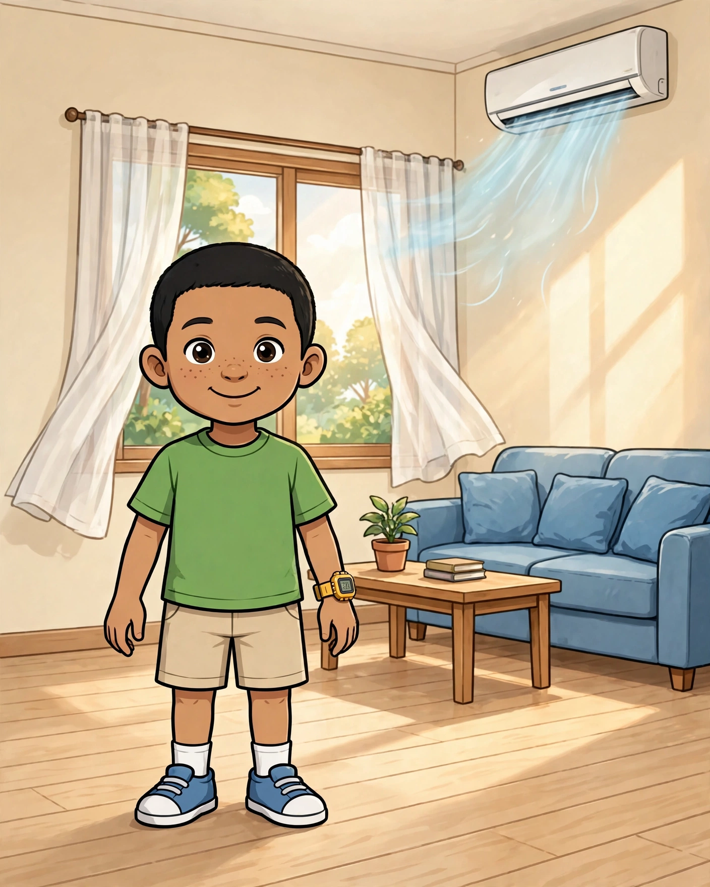
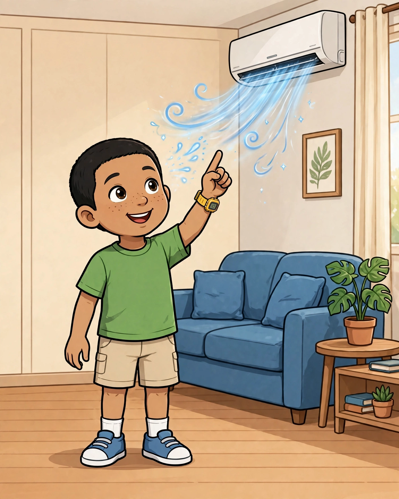
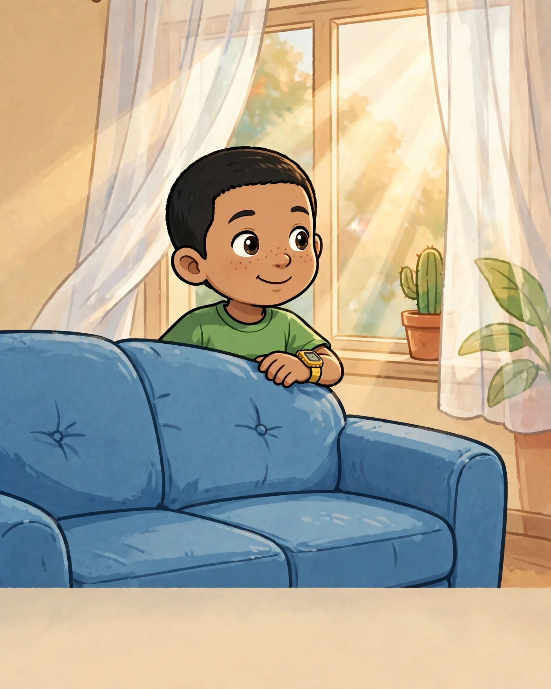
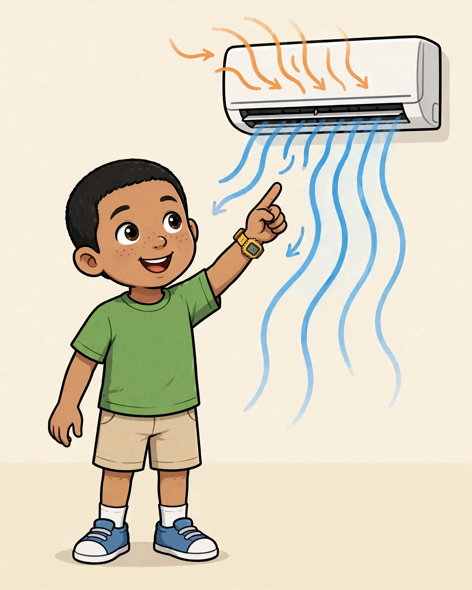
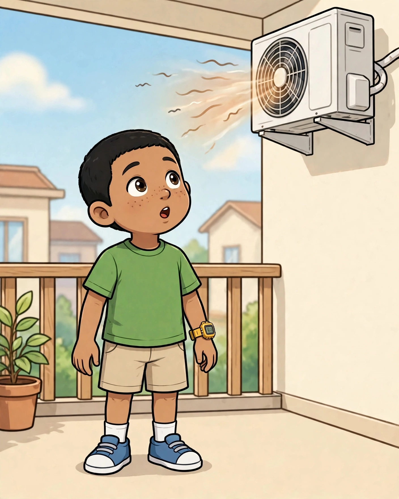
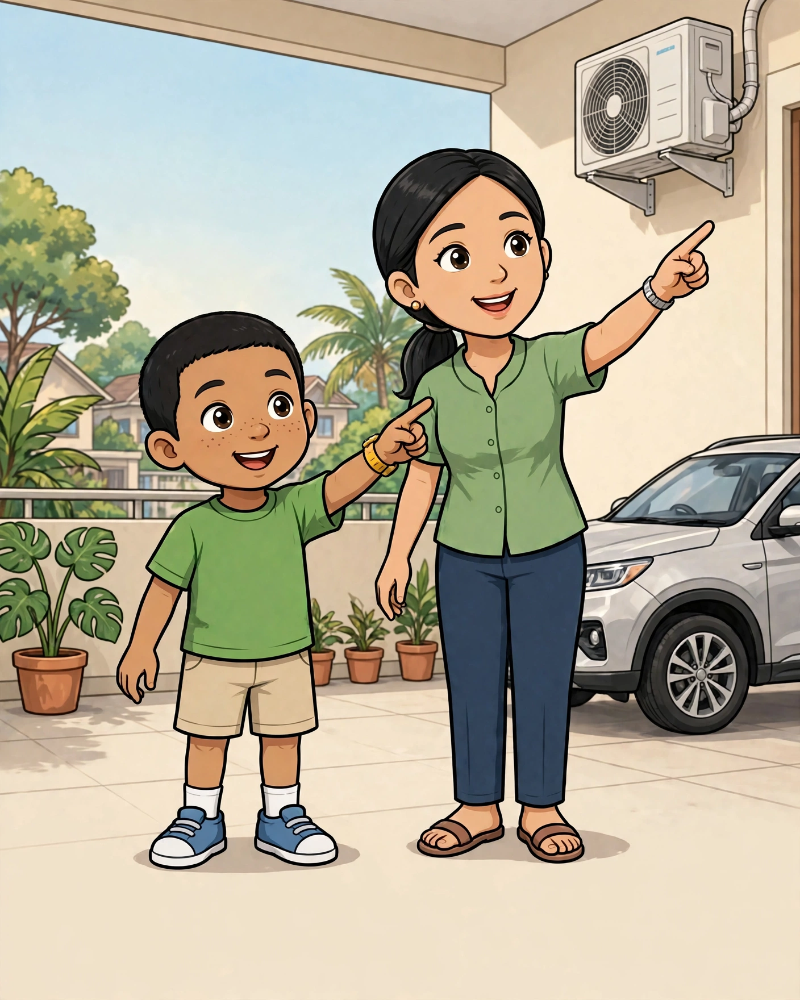
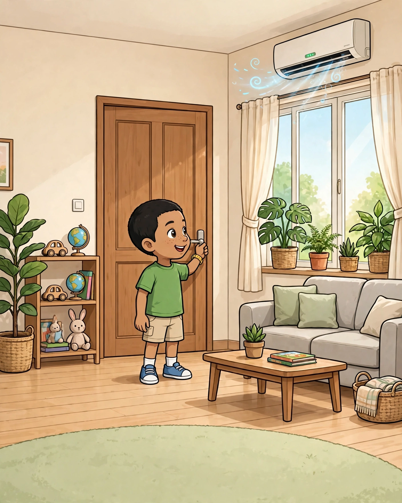

# Kenapa AC Bikin Dingin?

Yuk, ikuti perjalanan udara panas yang berubah menjadi sejuk di rumahmu!

_Topik: Cara kerja AC · Kategori: sains · Gaya gambar: kartun-anak_

## 1. Apa Itu AC?

AC adalah singkatan dari Air Conditioner, mesin pendingin udara yang membuat ruangan terasa sejuk dan nyaman. Saat dinyalakan, AC meniupkan udara sejuk ke seluruh ruangan, sehingga tubuh kita terasa adem meski cuaca di luar sedang panas. AC berbeda dengan kipas, karena AC benar-benar mendinginkan udara, bukan hanya menggerakkannya. Tapi, kenapa ya ruangan bisa terasa gerah sebelum AC dinyalakan?

> **Tahukah Kamu?** Lebih dari seratus tahun yang lalu, AC pertama di dunia dibuat bukan untuk membuat orang merasa sejuk, melainkan untuk menjaga kertas di sebuah percetakan agar tidak lembap dan berubah bentuk!

## 2. Kenapa Rumah Panas?

Matahari mengirimkan panas lewat sinarnya, dan saat sinar itu masuk lewat jendela, panasnya diserap oleh lantai, dinding, dan benda-benda di dalam rumah. Benda-benda yang hangat itu lalu menghangatkan udara di sekitarnya, sedikit demi sedikit, seperti air panas yang membuat gelasnya ikut hangat. Tubuh kita, lampu, dan alat listrik juga menambah panas, sementara udara hangat itu sulit keluar karena ruangan tertutup. Jadi, rumah bisa terasa gerah walaupun kita hanya duduk diam, lalu bagaimana caranya panas itu bisa hilang?

> **Tahukah Kamu?** Tahukah Kamu? Kaca jendela seperti perangkap panas: cahaya matahari mudah masuk, tetapi panasnya sulit keluar lagi, sehingga ruangan makin hangat seperti rumah kaca!

## 3. Cara AC Bekerja

Di dalam AC ada pipa yang sangat dingin, berisi cairan istimewa bernama refrigeran. Ketika udara hangat dari ruangan masuk dan melewati pipa itu, refrigeran menyerap panasnya, seperti es batu yang menyerap panas sehingga minuman menjadi dingin. Udara yang sudah kehilangan panasnya menjadi sejuk, lalu kipas di dalam AC meniupnya kembali ke ruangan, sementara refrigeran berubah menjadi gas dan berputar lagi untuk mendinginkan udara berikutnya. Jadi, AC tidak menciptakan dingin begitu saja, ia mengambil panas dari udara, lalu ke mana panas itu pergi?

> **Tahukah Kamu?** Tahukah Kamu? Saat udara hangat menyentuh pipa dingin di dalam AC, uap air yang tidak terlihat di udara berubah menjadi tetesan air, seperti embun pada botol minuman dingin, itulah air yang menetes dari pipa AC!

## 4. Wah, Panasnya Dibawa Keluar!

AC tidak menciptakan dingin, AC memindahkan panas dari dalam rumah ke luar rumah. Panas itu dibawa lewat pipa oleh refrigeran, yaitu zat pendingin khusus, seperti kurir yang mengantar paket panas sampai ke luar. Di luar, kipas pada kotak AC membuang panas itu ke udara, sehingga udara di dalam rumah terasa sejuk. Kalau panas bisa dipindahkan seperti itu, di mana lagi ya AC bekerja untuk membuat tempat terasa sejuk?

> **Tahukah Kamu?** Tahukah Kamu? Kulkas bekerja seperti AC kecil: ia mengambil panas dari makanan dan minuman di dalamnya, lalu membuang panas itu ke udara di sekitarnya, sehingga bagian belakang kulkas sering terasa hangat.

## 5. AC di Sekitar Kita

Ternyata AC tidak hanya ada di rumah, tetapi juga di mobil, bus, sekolah, dan toko, dan semuanya punya tugas yang sama: membuat udara di sekitar kita terasa sejuk. Walaupun bentuknya berbeda-beda, cara kerjanya mirip, seperti saudara yang memakai resep yang sama untuk membuat udara dingin. Jadi, saat hari panas, kita bisa merasa nyaman di banyak tempat, bukan hanya di ruang tamu. Lalu, bagaimana caranya supaya udara sejuk itu tidak cepat hilang begitu saja?

> **Tahukah Kamu?** Tahukah kamu? AC modern pertama di dunia dibuat bukan untuk membuat orang sejuk, melainkan untuk menjaga kertas di pabrik cetak agar tidak lembap dan mengembang!

## 6. Ayo Jaga Udara Sejuk

Udara sejuk mudah keluar lewat pintu dan jendela yang terbuka, seperti es dalam kotak yang cepat mencair kalau tutupnya dibiarkan terbuka. Kalau udara panas dari luar terus masuk, AC harus bekerja lebih keras dan memakai listrik lebih banyak untuk membuat ruangan sejuk lagi. Karena itu, kita bisa membantu dengan memakai AC secukupnya saja dan mematikannya saat ruangan tidak dipakai, supaya listrik tidak terbuang sia-sia. Coba amati di rumahmu: bagian ruangan mana yang paling cepat terasa sejuk, dan bagaimana rasanya saat pintunya dibiarkan terbuka sebentar?

> **Tahukah Kamu?** Daun tanaman mengeluarkan uap air melalui pori-pori kecilnya, seperti kita berkeringat, sehingga daun dan udara di sekitarnya bisa terasa sedikit lebih sejuk.

## Storyboard & Layout

| Halaman | Layout | Adegan gambar | Komposisi | Suasana | Kesinambungan |
| --- | --- | --- | --- | --- | --- |
| 1. Apa Itu AC? | gambar-atas | Banu berdiri di ruang tamu yang gerah sambil menunjuk AC dinding yang menyala dan merasakan angin sejuk dari AC. | Establishing wide, potret 4:5, sudut sejajar mata di ruang tamu terang. Banu utuh kepala sampai kaki, 70–80% lebar bingkai, area aman tengah, margin 10% semua sisi. AC putih di atas sofa jadi sorotan utama. Seperempat bawah hanya lantai kayu tenang, zona melt, tanpa bagian tokoh. | penasaran dan hangat | Baju hijau dan celana krem Banu sama di semua halaman. |
| 2. Kenapa Rumah Panas? | gambar-kanan | Banu bersembunyi setengah di balik sofa biru sambil memandang sinar matahari yang masuk lewat jendela dan merasakan udara ruangan yang panas. | Camouflage/hidden, potret 4:5, sudut sejajar mata dari sisi kanan. Banu utuh, 40–50% bingkai, setengah tersembunyi di balik sofa biru, area aman tengah, margin 10% semua sisi. Sinar matahari lewat jendela dan tirai putih jadi sorotan utama. Seperempat bawah hanya lantai kayu, zona melt. | gerah dan penasaran | Ruang tamu, sofa biru, dan baju Banu sama seperti halaman pertama. |
| 3. Cara AC Bekerja | gambar-kiri | Banu menunjuk AC putih sambil menunjukkan udara hangat yang masuk dan udara sejuk yang keluar dengan garis bergelombang oranye dan biru. | Action close-up, potret 4:5, sudut diagonal dinamis dari sisi kiri. Banu utuh, tampak besar di bingkai, area aman tengah, margin 10% semua sisi. Garis oranye udara hangat masuk dan garis biru udara sejuk keluar dari AC putih jadi sorotan utama. Seperempat bawah hanya lantai kayu, zona melt. | seru dan penuh tanya | AC putih dan ruang tamu yang sama seperti halaman sebelumnya. |
| 4. Wah, Panasnya Dibawa Keluar! | gambar-penuh | Banu menatap kagum unit luar AC di balkon sambil merasakan udara hangat yang keluar dari kipasnya. | Head-focus three-quarter, potret 4:5, sudut tiga perempat dari depan di balkon terang. Banu utuh, kepala dan mata kagumnya jadi fokus, area aman tengah, margin 10% semua sisi. Unit luar AC putih dengan kipas pengembus udara hangat jadi sorotan utama. Seperempat bawah hanya lantai balkon, zona melt. | kagum dan takjub | Banu memakai baju yang sama seperti halaman sebelumnya dan unit luarnya terhubung ke AC dalam yang sama. |
| 5. AC di Sekitar Kita | gambar-kanan | Banu dan Ibu Maya berdiri di teras rumah sambil menunjuk unit luar AC putih dan mobil keluarga di dekatnya. | Life-cycle/multi-subject, potret 4:5, sudut sejajar mata lebar di teras terang. Banu dan Ibu Maya utuh, skala berbeda, berdampingan condong ke kanan, area aman tengah, margin 10% semua sisi. Unit luar AC putih dan mobil keluarga jadi sorotan utama. Seperempat bawah hanya lantai teras, zona melt. | senang dan ingin tahu | Banu dan Ibu Maya memakai pakaian yang sama seperti yang ditetapkan di awal buku. |
| 6. Ayo Jaga Udara Sejuk | gambar-atas | Banu menutup pintu ruang tamu sambil tersenyum ke arah AC yang menyala dan tanaman hijau di dekat jendela. | Wide environment, potret 4:5, sudut sejajar mata di ruang tamu luas. Banu utuh, kecil 35–45% bingkai di tengah ruangan, area aman tengah, margin 10% semua sisi. Pintu tertutup, AC putih menyala, tanaman hijau di dekat jendela jadi sorotan utama. Seperempat bawah hanya lantai kayu, zona melt. | lega dan bersemangat | Ruang tamu, AC putih, dan baju Banu sama seperti halaman pertama. |

**Jangkar penampilan tokoh:** Banu: 7yo Indonesian boy, medium brown skin, short neat straight black hair, green T-shirt, beige shorts, white socks, blue sneakers, yellow digital watch LEFT, no wristband. Ibu Maya: adult woman, warm tan skin, long black hair low ponytail, soft green blouse, dark-blue trousers, brown sandals, gold stud earrings, silver watch LEFT wrist. AC: slim white wall-mounted air conditioner, smooth front panel, thin horizontal vent flap, small round display light right side, white pipe down the wall.

**Jangkar tempat:** A bright, tidy Indonesian family living room with cream walls, a light wooden floor, a blue sofa, a small wooden table, a window with sheer white curtains letting in warm afternoon sunlight, and a white wall-mounted air conditioner above the sofa, in a calm, cosy and cheerful mood.

## Panduan Gambar Buku Anak (mengikat untuk semua gambar buku ini)

Panduan ini mengikat: perintah gambar sampul dan semua halaman di semua buku selalu memuat panduan ini, dan setiap gambar dicek dengan daftar periksa di bawah sebelum tampil. Tujuannya satu — tokoh selalu tampil utuh, dan emosi serta maksud adegannya langsung kebaca oleh anak kelas 2 SD.

1. Tokoh utuh selalu: seluruh tubuh tokoh — kepala, badan, tangan, dan kaki — terlihat lengkap di dalam bingkai, dari kepala sampai kaki.
2. Ruang aman di semua sisi: ada jarak latar yang jelas (kira-kira sepersepuluh bingkai) antara tokoh dan setiap tepi gambar; tokoh tidak pernah menyentuh atau melewati tepi.
3. Dilarang close-up ekstrem: jangan memperbesar satu bagian tubuh atau wajah sampai tokohnya sendiri hilang. Detail boleh ditonjolkan hanya bila seluruh tokoh tetap terlihat dalam bingkai yang sama.
4. Langsung kebaca sekali lihat: anak kelas 2 harus bisa mengenali tokohnya, apa yang sedang ia lakukan, dan apa yang ia rasakan dalam sekali pandang — satu subjek yang jelas, satu aksi yang jelas, satu emosi yang jelas.
5. Latar lengkap tapi selalu di belakang: tempat adegannya digambar utuh dan mudah dikenali di belakang dan di sekeliling tokoh; tidak ada benda apa pun yang menutupi kepala atau tubuh tokoh.
6. Tanpa teks di dalam gambar: tidak ada kata, huruf, atau angka di gambar. Semua tulisan dipasang sebagai teks asli di halaman buku, bukan digambar.
7. Rasio gambar 4:5 potret, selalu: setiap gambar halaman digambar dalam bingkai potret 4:5 (tegak, 1408x1760) — BUKAN lanskap. Halaman dibaca potret satu halaman penuh: gambar 4:5 berdiri di atas, teks di zona kertas di bawahnya. Tokoh memakai sebagian besar lebar bingkai — sekitar 70–80% — supaya gambarnya terasa penuh dan tokohnya besar, tetap utuh dengan ruang aman latar di semua sisi, dan teks TIDAK dicetak di dalam gambar.
8. Seperempat bawah = safe space transisi: seperempat bagian bawah gambar WAJIB tenang — latar depan sederhana minim detail (lantai atau tanah lembut, air, atau rumput polos) yang warnanya melebur perlahan (gradasi mulus, tanpa garis keras) ke arah warna kertas krem buku. Di mode baca, safe space inilah yang bertransisi langsung ke teks di bawahnya, jadi tokoh dan detail penting TIDAK BOLEH masuk ke seperempat bawah ini; tokoh berdiri di tiga perempat atas bingkai, kakinya boleh menyentuh tepi atas safe space.
9. Kartun ceria, bukan realistis: ilustrasi kartun ala buku cerita anak — karakter ekspresif dengan wajah ramah dan emosi yang jelas terbaca (senang, penasaran, sayang, terkejut), garis lembut dan bentuk membulat yang ramah, warna hangat cerah dari palet terkunci buku, latar sederhana yang tidak menutupi tokoh. Dilarang: rendering fotorealistis, proporsi alami ala panduan alam, warna naturalis redup, garis tepi hitam tebal yang kasar, dan wajah yang menakutkan.
10. Crop-safe — margin aman di KEEMPAT sisi: seluruh tokoh harus utuh di dalam frame dengan margin yang jelas di keempat sisi — minimal sekitar 10% lebar/tinggi frame dari setiap tepi (atas, bawah, kiri, kanan). Kepala sampai kaki kelihatan penuh; tidak ada satu pun bagian tokoh yang menyentuh, melewati, atau terpotong tepi frame. Aturan ini lahir dari halaman 4 'Rahasia Tahan Tanpa Makan' yang ke-crop di tablet: ularnya hanya kelihatan sebagian badan di tepi bawah dan kepalanya tidak kelihatan sama sekali.
11. Crop-safe — tokoh di area aman tengah: tokoh wajib berada di area aman tengah, kira-kira 80% bagian tengah frame — jangan pernah menaruh subjek dekat tepi. Alasannya: gambar yang sama bisa tampil sedikit terpotong saat ditampilkan di layar yang berbeda (phone vs tablet portrait), jadi komposisi harus tetap aman walaupun tepinya kepotong sedikit. Kalau ragu, kecilkan sedikit tokohnya dan beri latar lebih lega daripada menaruhnya mepet tepi.
12. Crop-safe — zona melt bawah HANYA berisi latar: seperempat bawah gambar (zona melt / safe space yang meleleh lewat gradasi ke teks di bawahnya) HANYA boleh berisi latar — lantai, tanah, air, rumput polos, atau latar tenang lain. Tidak boleh ada bagian tokoh apa pun di zona itu: tidak ada badan, tidak ada tangan atau kaki, dan terutama tidak ada kepala yang masuk ke zona melt. Tokoh selesai sepenuhnya di atas zona melt; kakinya hanya boleh menyentuh tepi atas zona itu.
13. Crop-safe — QA wajib dicek di tablet portrait juga: setiap gambar hasil generate/regenerate wajib dicek tampilannya di ukuran tablet portrait (2136x3200) selain di phone. Gambar yang lolos QA di phone BELUM TENTU lolos di tablet — halaman 4 lolos di phone tetapi ke-crop di tablet — jadi gambar belum boleh dinyatakan lolos sebelum tampil utuh (kepala sampai kaki, margin aman terlihat) di kedua ukuran itu.
14. Variasi shot — kamera wajib berpindah antar halaman: dalam satu buku, TIDAK ADA dua halaman yang boleh memakai jenis shot yang sama. Setiap buku wajib merotasi minimal 4 jenis shot berbeda dari daftar ini: (a) establishing wide — tampak lebar pembuka, tokoh utuh memakai sekitar 70–80% lebar bingkai; (b) camouflage/hidden — tokoh LEBIH KECIL (sekitar 40–50% lebar bingkai), setengah tersembunyi di balik benda di tempat adegannya, pembaca harus menemukannya; (c) action close-up — momen aksi, tokoh lebih besar di bingkai dengan sudut dinamis/diagonal, seluruh tubuh tetap utuh; (d) head-focus three-quarter — dilihat tiga perempat, kepala dan mata jadi titik fokus, seluruh badan tetap utuh di area aman; (e) life-cycle/multi-subject — dua subjek atau lebih dengan skala berbeda dalam framing lebih lebar (misalnya dua anak bermain bersama, atau tokoh bersama teman/hewan peliharaannya); (f) wide environment — lingkungan luas memenuhi bingkai, tokoh kecil (sekitar 35–45% lebar bingkai) di tengahnya. Generator storyboard wajib menetapkan satu jenis shot BERBEDA untuk setiap halaman sejak awal dan menuliskannya di awal composition halaman itu; skala tokoh mengikuti jenis shot-nya, BUKAN selalu 70–80%. Semua aturan lain tetap mengikat di setiap shot: tokoh utuh, margin aman ~10% di keempat sisi, tokoh di area aman tengah, seperempat bawah hanya latar. QA wajib memeriksa VARIASI SHOT antar halaman sebelum buku dinyatakan siap — bukan hanya memeriksa tiap gambar satu per satu. Aturan ini lahir dari buku Belalang Sembah yang keenam halamannya memakai komposisi hampir copy-paste (samping agak jauh, 70–80%, di tengah) sehingga bukunya terasa monoton walau adegannya berbeda.
15. Tokoh manusia bernama: sebelum generate ilustrasi apa pun, setiap tokoh manusia yang namanya muncul di naskah harus sudah punya deskripsi penampilan terkunci; deskripsi itu dipakai kata-per-kata di semua halaman tempat tokoh itu muncul; jangan menggambar tokoh dari teks halaman saja. Deskripsi wajib memuat warna kulit, rambut, pakaian, aksesori beserta warna dan letaknya (kiri/kanan), dan ciri khas. (Aturan ini lahir dari buku 'Nara Berkata Jujur, Hati Tenang': Sinta tidak punya deskripsi terkunci sehingga hal. 4 dan 5 menggambarkannya berbeda.)

**Daftar periksa QA sebelum gambar tampil:**

- [ ] Subjek utuh? Seluruh tokoh terlihat dari kepala sampai kaki.
- [ ] Kepala terlihat? Kepala tokoh tampak jelas dan lengkap.
- [ ] Tidak terpotong tepi? Tidak ada bagian tubuh yang kepotong tepi gambar mana pun.
- [ ] Rasio 4:5 potret? Gambar tegak 4:5 (1408x1760), tokoh memakai sebagian besar lebar bingkai (sekitar 70–80%) di tiga perempat atasnya.
- [ ] Safe space bawah bersih? Seperempat bawah gambar tenang dan minim detail, melebur gradasi ke warna kertas — tidak ada tokoh atau detail penting di sana, siap bertransisi ke teks.
- [ ] Tidak ada teks liar? Gambar bebas kata, huruf, dan angka.
- [ ] Sekali lihat kebaca? Anak langsung tahu siapa tokohnya, sedang apa, dan apa yang ia rasakan.
- [ ] Cukup kartun dan ekspresif? Wajah ramah, emosi jelas terbaca, garis lembut, warna hangat cerah — tidak terlihat seperti ilustrasi panduan alam yang realistis.
- [ ] Margin aman keempat sisi? Ada jarak latar yang jelas (minimal ~10% frame) antara tokoh dan SETIAP tepi — atas, bawah, kiri, kanan — dan tidak ada bagian tokoh yang menyentuh atau memotong tepi mana pun.
- [ ] Tokoh di area aman tengah? Seluruh tokoh berada di ~80% bagian tengah frame, tidak ada bagian subjek yang ditaruh dekat tepi, jadi gambar tetap aman walau tampil sedikit terpotong di layar lain.
- [ ] Zona melt bawah bersih total? Seperempat bawah gambar HANYA berisi latar — tidak ada badan, tangan, kaki, atau kepala tokoh di zona melt itu.
- [ ] Sudah dicek di tablet portrait? Gambar sudah dilihat di ukuran tablet portrait (2136x3200) DAN di phone, dan tokoh tampil utuh kepala sampai kaki dengan margin aman di kedua ukuran itu — lolos di phone saja tidak cukup.
- [ ] Variasi shot antar halaman? Setiap halaman memakai jenis shot yang BERBEDA (establishing wide / camouflage-hidden / action close-up / head-focus three-quarter / life-cycle multi-subject / wide environment) dan buku merotasi minimal 4 jenis shot — tidak ada dua halaman dengan kamera, jarak, dan skala tokoh yang sama.
- [ ] Tokoh manusia bernama konsisten? Setiap tokoh manusia bernama memakai deskripsi penampilan terkunci yang sama kata-per-kata di semua halaman tempat ia muncul — tidak ada tokoh yang digambar berbeda antar halaman.
