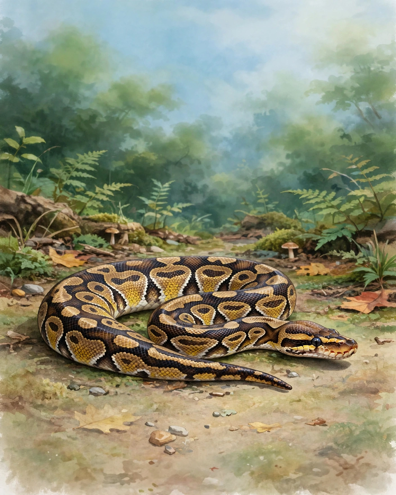
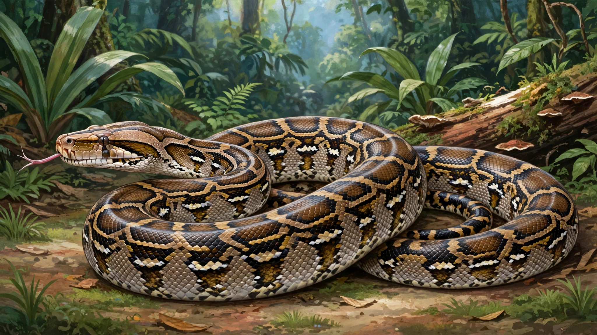
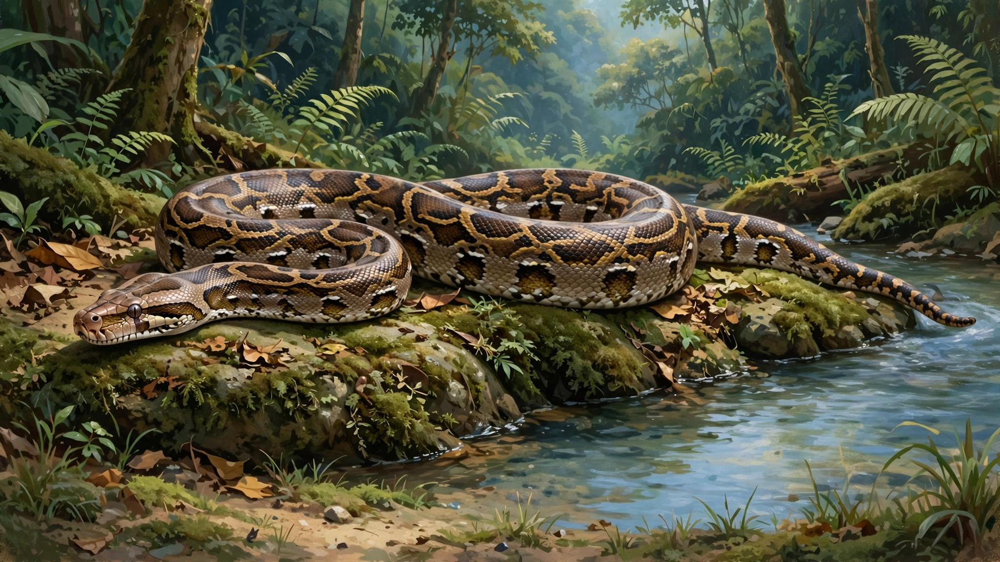
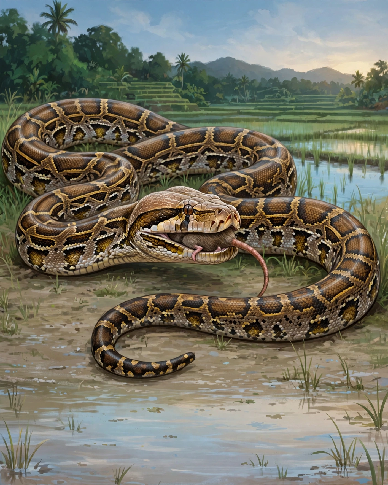
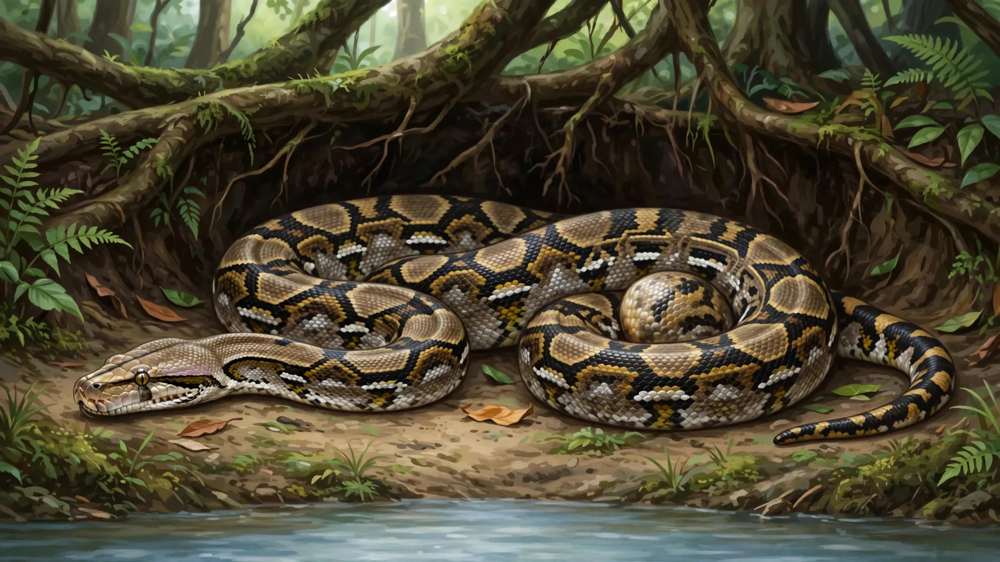
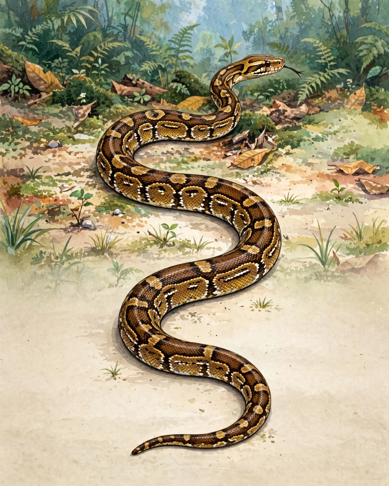
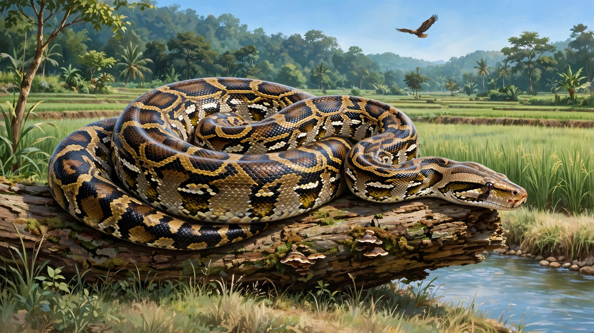

# Ular Hebat Tanpa Makan Lama

Ayo kenali ular, hewan hemat energi yang bisa bertahan lama tanpa makan!

_Topik: Kenapa ular bisa tahan tanpa makan · Gaya gambar: semi-realistis_

## 1. Kenalan dengan Ular

Ular adalah reptil, yaitu hewan bersisik yang tubuhnya panjang, lentur, dan tidak mempunyai kaki. Sisiknya melindungi tubuhnya, sedangkan pola belang, bintik, atau garis pada kulitnya membantunya bersembunyi di antara daun dan tanah. Lidahnya yang bercabang sering dijulurkan untuk menangkap bau di udara, dan matanya membantunya melihat gerakan di sekitarnya. Ular sanca, salah satu ular di Indonesia, dikenal sebagai salah satu ular terpanjang di dunia.

> **Tahukah Kamu?** Ular tidak mempunyai kelopak mata, jadi matanya dilindungi lapisan bening dan selalu terbuka, bahkan saat ia tidur.

## 2. Rumah Ular di Alam

Ular tinggal di banyak tempat, seperti hutan hujan, sawah, tepi sungai, padang rumput, dan bahkan gurun. Ada ular yang hidup di pohon, ada yang pandai berenang di air, dan ada pula yang bersembunyi di dalam tanah atau di bawah batu. Karena ular adalah hewan berdarah dingin, artinya suhu tubuhnya mengikuti suhu di sekitarnya, ia suka berjemur di bawah sinar matahari untuk menghangatkan tubuh. Saat udara terlalu panas atau terlalu dingin, ular akan bersembunyi di tempat teduh atau di dalam lubang agar tubuhnya tetap nyaman.

> **Tahukah Kamu?** Ada ular laut yang ekornya pipih seperti dayung, sehingga ia bisa berenang dengan cepat di laut.

## 3. Makanan dan Cara Berburu

Ular adalah karnivora, yaitu hewan pemakan daging, dan ia memangsa tikus, burung, katak, ikan, telur, serta hewan kecil lainnya. Ular tidak mengunyah makanannya, melainkan menelannya bulat-bulat dengan bantuan rahangnya yang bisa membuka sangat lebar dan gigi yang melengkung ke belakang untuk menahan mangsa. Ada ular yang melilit mangsanya dengan kuat, ada yang menggunakan bisa, yaitu cairan beracun, untuk melumpuhkan mangsa, dan ada pula yang menunggu dengan sabar sampai mangsa datang mendekat. Setelah menelan satu mangsa yang besar, ular bisa merasa kenyang untuk waktu yang sangat lama.

> **Tahukah Kamu?** Ada ular berbisa yang memiliki lubang kecil di wajahnya untuk merasakan panas tubuh mangsa, sehingga ia bisa berburu dalam gelap.

## 4. Rahasia Tahan Tanpa Makan

Rahasia ular tahan lama tanpa makan adalah metabolismenya yang lambat, yaitu cara tubuhnya memakai energi dari makanan berjalan sangat pelan. Berbeda dengan kita yang memakai banyak energi untuk menjaga tubuh tetap hangat, ular tidak perlu melakukan itu karena suhu tubuhnya mengikuti suhu lingkungan. Saat sudah makan mangsa besar, ular menyimpan sebagian energi itu sebagai lemak di tubuhnya dan menggunakannya sedikit demi sedikit, seperti menabung makanan. Karena ia bergerak pelan dan banyak beristirahat, energi itu tidak cepat habis, sehingga beberapa ular besar bisa bertahan berminggu-minggu bahkan berbulan-bulan tanpa makan, tetapi ia tetap perlu minum air.

> **Tahukah Kamu?** Usus ular sanca bisa mengecil saat ia lama tidak makan, lalu membesar lagi setelah ia makan untuk mencerna mangsanya.

## 5. Cara Ular Hidup

Ular bergerak dengan merayap, yaitu menggerakkan otot-otot tubuh dan sisik perutnya untuk mendorong tubuh ke depan di atas tanah. Beberapa ular juga pandai memanjat pohon dan berenang, sehingga mereka bisa mencari makan di banyak tempat. Untuk mencari mangsa dan mengenali lingkungannya, ular menjulurkan lidah bercabangnya untuk menangkap bau, lalu bau itu dibaca oleh organ Jacobson, yaitu organ khusus di langit-langit mulutnya. Kebanyakan ular hidup sendiri, dan setelah bertelur atau melahirkan anak, induknya biasanya pergi, sehingga anak ular harus mencari makan sendiri sejak kecil.

> **Tahukah Kamu?** Ular tidak mempunyai telinga luar, tetapi ia bisa merasakan getaran langkah hewan lain melalui tanah dan rahangnya.

## 6. Penjaga Alam yang Hebat

Ular berperan penting di alam sebagai pemburu tikus dan hewan kecil lainnya, sehingga jumlah hewan itu tidak bertambah terlalu banyak dan merusak tanaman petani. Ular juga menjadi makanan bagi elang dan hewan lain, sehingga ia membantu menjaga rantai makanan tetap seimbang. Jika ular hilang, tikus bisa berkembang biak dengan cepat dan sawah bisa rusak, jadi menjaga ular berarti menjaga alam dan hasil panen kita. Mari kita menyayangi ular dengan tidak mengganggunya, tidak membunuhnya, dan memberi tahu orang dewasa jika kita melihat ular dari jarak yang aman.

> **Tahukah Kamu?** Para ilmuwan mempelajari bisa ular untuk membuat obat yang dapat menolong manusia yang sakit.

## Storyboard & Layout

| Halaman | Layout | Adegan gambar | Komposisi | Suasana | Kesinambungan |
| --- | --- | --- | --- | --- | --- |
| 1. Kenalan dengan Ular | gambar-atas | - | - | - | - |
| 2. Rumah Ular di Alam | gambar-atas | - | - | - | - |
| 3. Makanan dan Cara Berburu | gambar-atas | - | - | - | - |
| 4. Rahasia Tahan Tanpa Makan | gambar-atas | - | - | - | - |
| 5. Cara Ular Hidup | gambar-atas | - | - | - | - |
| 6. Penjaga Alam yang Hebat | gambar-atas | - | - | - | - |

**Jangkar penampilan hewan:** -

**Jangkar habitat:** -

## Panduan Gambar Buku Fauna (mengikat untuk semua gambar buku ini)

Panduan ini mengikat: perintah gambar sampul dan semua halaman di semua buku selalu memuat panduan ini, dan setiap gambar dicek dengan daftar periksa di bawah sebelum tampil. Tujuannya satu — hewan selalu tampil utuh dan langsung kebaca oleh anak kelas 2 SD.

1. Hewan utuh selalu: seluruh tubuh hewan — kepala, badan, kaki/sayap/sirip, dan ekor — terlihat lengkap di dalam bingkai, dari kepala sampai ekor.
2. Ruang aman di semua sisi: ada jarak latar yang jelas (kira-kira sepersepuluh bingkai) antara hewan dan setiap tepi gambar; hewan tidak pernah menyentuh atau melewati tepi.
3. Dilarang close-up ekstrem: jangan memperbesar satu bagian tubuh atau pola kulit sampai hewannya sendiri hilang. Detail boleh ditonjolkan hanya bila seluruh hewan tetap terlihat dalam bingkai yang sama.
4. Langsung kebaca sekali lihat: anak kelas 2 harus bisa mengenali hewannya dan apa yang sedang ia lakukan dalam sekali pandang — satu subjek yang jelas, satu aksi yang jelas.
5. Latar habitat lengkap tapi selalu di belakang: habitat digambar utuh dan mudah dikenali di belakang dan di sekeliling hewan; tidak ada tanaman, batu, atau benda apa pun yang menutupi kepala atau tubuh hewan.
6. Tanpa teks di dalam gambar: tidak ada kata, huruf, atau angka di gambar. Semua tulisan dipasang sebagai teks asli di halaman buku, bukan digambar.
7. Rasio gambar 4:5 potret, selalu: setiap gambar halaman digambar dalam bingkai potret 4:5 (tegak, 1408x1760) — BUKAN lanskap. Halaman dibaca potret satu halaman penuh: gambar 4:5 berdiri di atas, teks di zona kertas di bawahnya. Hewan memakai sebagian besar lebar bingkai — sekitar 70–80% — supaya gambarnya terasa penuh dan hewannya besar, tetap utuh dengan ruang aman latar di semua sisi, dan teks TIDAK dicetak di dalam gambar.
8. Seperempat bawah = safe space transisi: seperempat bagian bawah gambar WAJIB tenang — latar depan sederhana minim detail (tanah lembut, air, atau rumput polos) yang warnanya melebur perlahan (gradasi mulus, tanpa garis keras) ke arah warna kertas krem buku. Di mode baca, safe space inilah yang bertransisi langsung ke teks di bawahnya, jadi hewan dan detail penting TIDAK BOLEH masuk ke seperempat bawah ini; hewan berdiri di tiga perempat atas bingkai, kakinya boleh menyentuh tepi atas safe space.
9. Realistis, bukan kartun: ilustrasi semi-realistis bergaya buku panduan alam modern — proporsi tubuh alami (kepala dan mata seukuran aslinya, tidak dibesarkan, tidak imut/chibi), warna persis warna asli spesiesnya (palet buku hanya memandu habitat dan latar, tidak mewarnai ulang hewan jadi warna kartun cerah), tekstur permukaan detail (sisik yang bertumpuk, helaian bulu, bulu halus terlihat satu per satu), serta cahaya dan bayangan lembut yang realistis sehingga hewan terasa bervolume dan berat. Dilarang: garis tepi hitam tebal ala kartun, bidang warna datar tanpa gradasi/bayangan, bentuk geometris yang disederhanakan, dan shading sel kartun.
10. Crop-safe — margin aman di KEEMPAT sisi: seluruh hewan harus utuh di dalam frame dengan margin yang jelas di keempat sisi — minimal sekitar 10% lebar/tinggi frame dari setiap tepi (atas, bawah, kiri, kanan). Kepala sampai ekor kelihatan penuh; tidak ada satu pun bagian hewan yang menyentuh, melewati, atau terpotong tepi frame. Aturan ini lahir dari halaman 4 'Rahasia Tahan Tanpa Makan' yang ke-crop di tablet: ularnya hanya kelihatan sebagian badan di tepi bawah dan kepalanya tidak kelihatan sama sekali.
11. Crop-safe — hewan di area aman tengah: hewan wajib berada di area aman tengah, kira-kira 80% bagian tengah frame — jangan pernah menaruh subjek dekat tepi. Alasannya: gambar yang sama bisa tampil sedikit terpotong saat ditampilkan di layar yang berbeda (phone vs tablet portrait), jadi komposisi harus tetap aman walaupun tepinya kepotong sedikit. Kalau ragu, kecilkan sedikit hewannya dan beri latar lebih lega daripada menaruhnya mepet tepi.
12. Crop-safe — zona melt bawah HANYA berisi latar: seperempat bawah gambar (zona melt / safe space yang meleleh lewat gradasi ke teks di bawahnya) HANYA boleh berisi latar/habitat — tanah, air, rumput polos, atau latar tenang lain. Tidak boleh ada bagian hewan apa pun di zona itu: tidak ada badan, tidak ada kaki/sayap/sirip, dan terutama tidak ada kepala atau ekor yang masuk ke zona melt. Hewan selesai sepenuhnya di atas zona melt; kakinya hanya boleh menyentuh tepi atas zona itu.
13. Crop-safe — QA wajib dicek di tablet portrait juga: setiap gambar hasil generate/regenerate wajib dicek tampilannya di ukuran tablet portrait (2136x3200) selain di phone. Gambar yang lolos QA di phone BELUM TENTU lolos di tablet — halaman 4 lolos di phone tetapi ke-crop di tablet — jadi gambar belum boleh dinyatakan lolos sebelum tampil utuh (kepala sampai ekor, margin aman terlihat) di kedua ukuran itu.

**Daftar periksa QA sebelum gambar tampil:**

- [ ] Subjek utuh? Seluruh hewan terlihat dari kepala sampai ekor.
- [ ] Kepala terlihat? Kepala hewan tampak jelas dan lengkap.
- [ ] Tidak terpotong tepi? Tidak ada bagian tubuh yang kepotong tepi gambar mana pun.
- [ ] Rasio 4:5 potret? Gambar tegak 4:5 (1408x1760), hewan memakai sebagian besar lebar bingkai (sekitar 70–80%) di tiga perempat atasnya.
- [ ] Safe space bawah bersih? Seperempat bawah gambar tenang dan minim detail, melebur gradasi ke warna kertas — tidak ada hewan atau detail penting di sana, siap bertransisi ke teks.
- [ ] Tidak ada teks liar? Gambar bebas kata, huruf, dan angka.
- [ ] Sekali lihat kebaca? Anak langsung tahu hewan apa ini dan sedang apa.
- [ ] Cukup realistis? Proporsi alami, mata tidak dibesarkan, warna sesuai spesies aslinya, tekstur permukaan detail, ada cahaya-bayangan lembut — tidak terlihat seperti kartun pipih bergaris tebal.
- [ ] Margin aman keempat sisi? Ada jarak latar yang jelas (minimal ~10% frame) antara hewan dan SETIAP tepi — atas, bawah, kiri, kanan — dan tidak ada bagian hewan yang menyentuh atau memotong tepi mana pun.
- [ ] Hewan di area aman tengah? Seluruh hewan berada di ~80% bagian tengah frame, tidak ada bagian subjek yang ditaruh dekat tepi, jadi gambar tetap aman walau tampil sedikit terpotong di layar lain.
- [ ] Zona melt bawah bersih total? Seperempat bawah gambar HANYA berisi latar/habitat — tidak ada badan, kaki, sayap, sirip, kepala, atau ekor hewan di zona melt itu.
- [ ] Sudah dicek di tablet portrait? Gambar sudah dilihat di ukuran tablet portrait (2136x3200) DAN di phone, dan hewan tampil utuh kepala sampai ekor dengan margin aman di kedua ukuran itu — lolos di phone saja tidak cukup.
