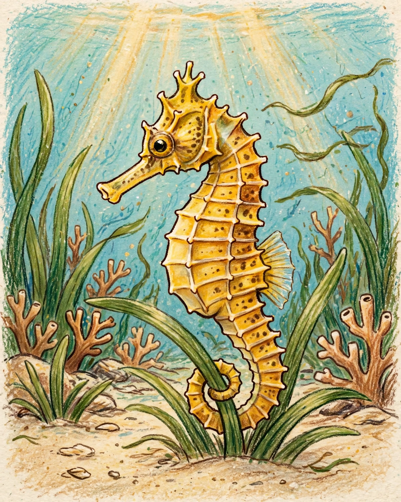
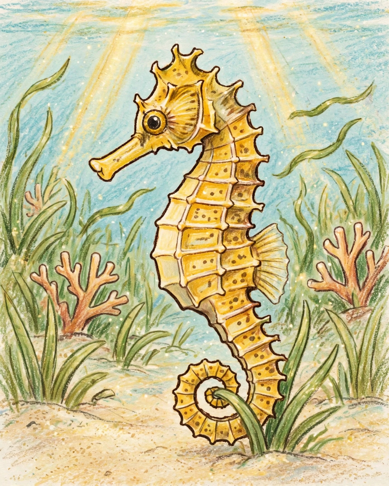
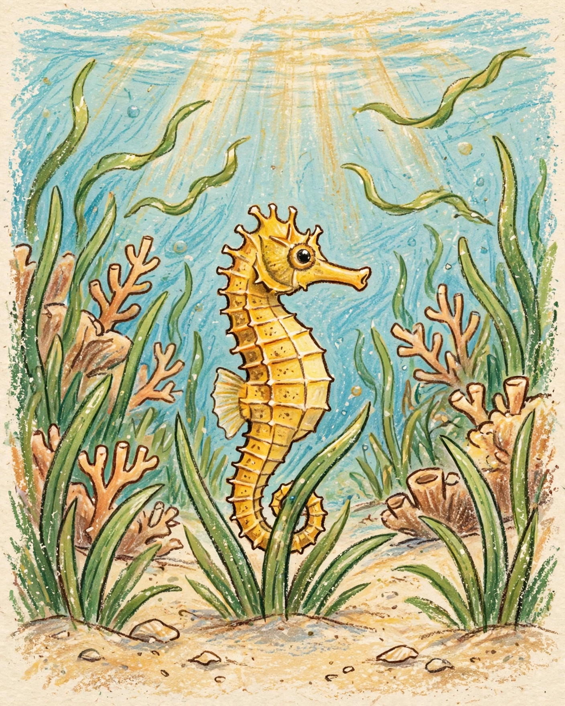
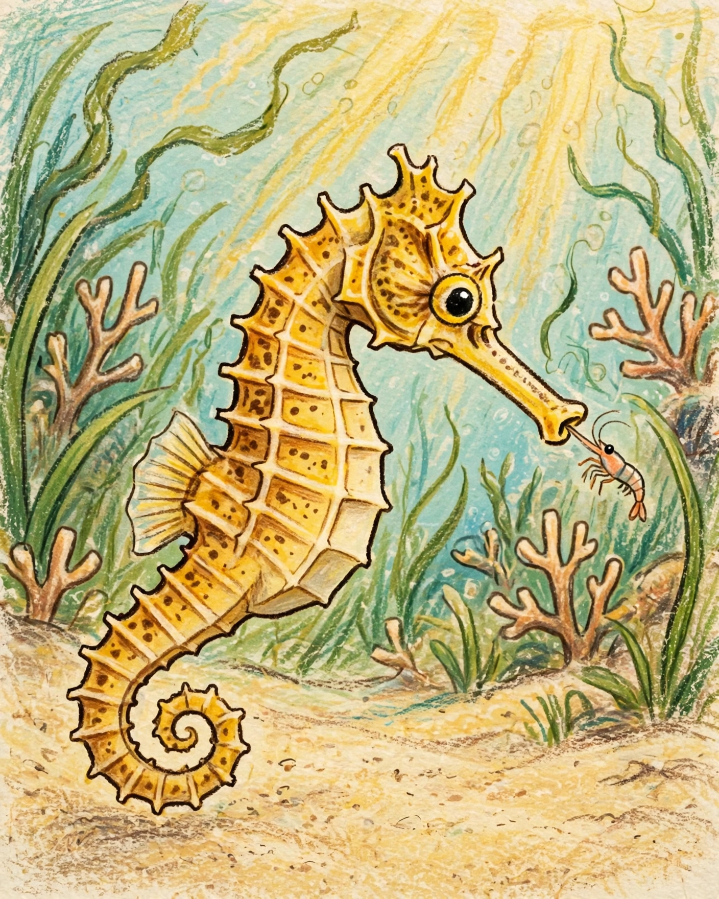
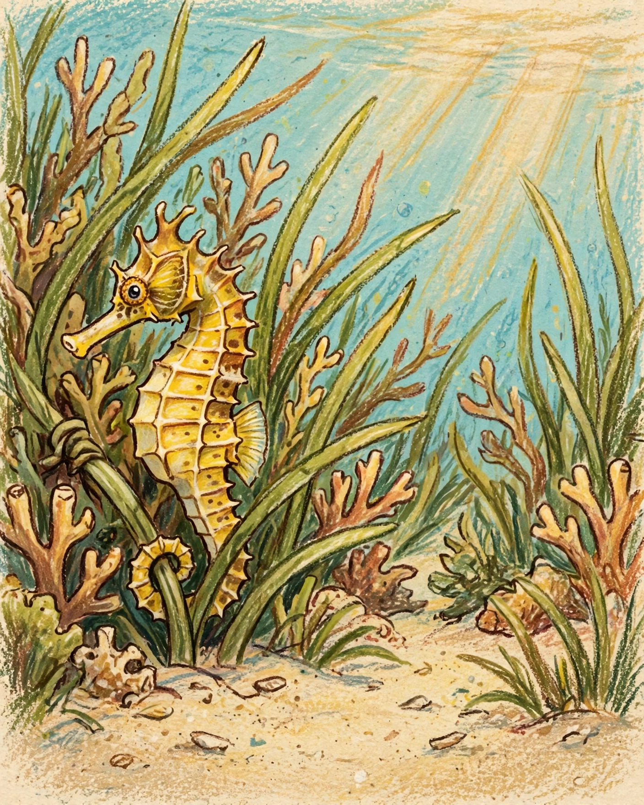
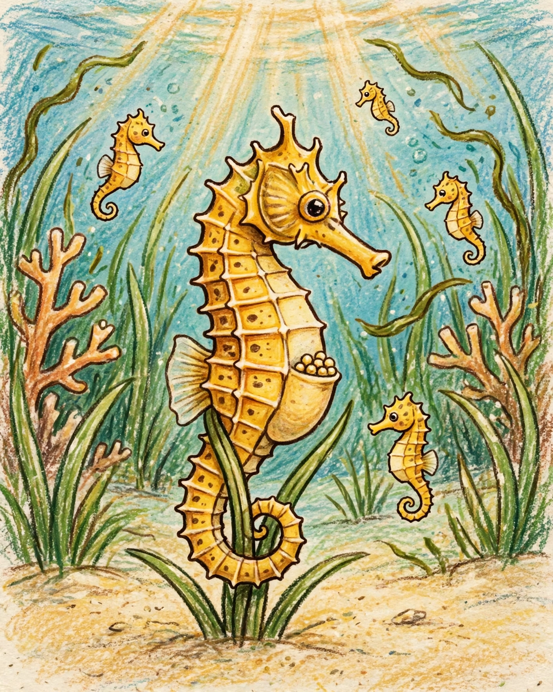
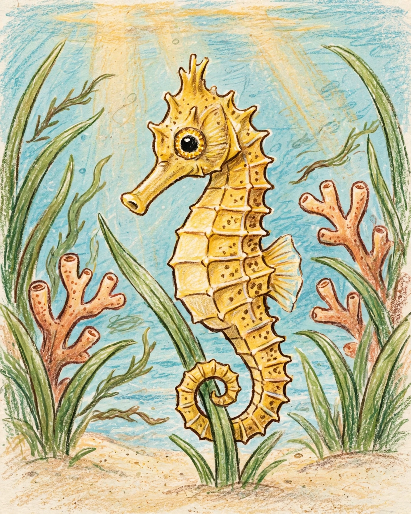

# Kuda Laut, Si Ikan Ajaib

Ayo menyelam dan temukan rahasia ikan kecil yang berenang tegak, pandai menyamar, dan dijaga oleh ayahnya!

_Topik: Kuda laut · Kategori: fauna · Gaya gambar: krayon_

## 1. Kuda Laut yang Unik

Yuk, kenalan dengan kuda laut! Kuda laut itu sebenarnya ikan. Ia bernapas dengan insang, alat di sisi kepalanya untuk bernapas di dalam air. Sirip-sirip mungilnya membantunya berenang tegak. Tubuhnya tidak ditutupi sisik yang licin, melainkan pelat tulang yang keras seperti baju zirah. Matanya yang besar bisa bergerak sendiri-sendiri, satu mata dapat melihat ke depan sementara mata yang lain mengintip ke belakang. Aneh dan hebat, ya? Tapi di mana ya rumah hewan istimewa ini?

> **Tahukah Kamu?** Tahukah Kamu? Ekor kuda laut ternyata berbentuk kotak, bukan bulat, dan bentuk kotak itu membuat ekornya kuat sekaligus lentur untuk mencengkeram.

## 2. Rumah di Padang Lamun

Kuda laut tinggal di laut dangkal yang hangat, di antara padang lamun yang tumbuh seperti rumput di dasar laut. Lamun bukan rumput biasa, melainkan tumbuhan laut yang akarnya menancap di pasir dan daunnya bergoyang lembut mengikuti arus. Di sinilah kuda laut berpegangan dengan ekornya yang bisa menggenggam, supaya tubuhnya yang berenang pelan tidak terseret arus dan ia bisa beristirahat dengan tenang. Padahal, di padang lamun yang tenang ini juga hidup banyak hewan kecil. Lalu, bagaimana kuda laut menangkap makanannya tanpa berenang jauh?

> **Tahukah Kamu?** Tahukah Kamu? Kedua mata kuda laut bisa bergerak sendiri-sendiri: satu mata melihat ke depan, sementara mata lainnya melihat ke belakang, jadi ia bisa mengawasi seluruh padang lamun tanpa perlu berputar!

## 3. Makan dengan Sedotan Ajaib

Kuda laut tidak punya gigi, jadi ia tidak bisa mengunyah. Moncongnya yang berbentuk tabung bekerja seperti sedotan. Begitu udang kecil lewat di depannya, kuda laut menengadahkan kepala dengan cepat dan menyedotnya, lalu menelannya bulat-bulat. Kuda laut juga tidak punya perut untuk menyimpan makanan, jadi makanan itu cepat lewat di tubuhnya dan ia harus makan sedikit-sedikit hampir sepanjang hari. Hebat sekali, ya? Tapi bagaimana kuda laut bisa mendekati udang tanpa ketahuan?

> **Tahukah Kamu?** Sedotan kuda laut bekerja lebih cepat daripada kedipan mata, sehingga udang kecil tersedot masuk dalam sekejap sebelum sempat kabur!

## 4. Jago Menyamar Hebat

Kuda laut pandai sekali bersembunyi, karena kulitnya bisa berubah warna mengikuti tempat di sekitarnya. Di dalam kulitnya ada sel warna kecil bernama kromatofor, kantong warna yang bisa membesar atau mengecil untuk mengubah warna tubuhnya. Sambil diam tak bergerak, benjolan kecil di tubuhnya juga membantu memecah bentuk tubuhnya. Dengan begitu ia tampak seperti bagian dari lamun dan karang. Kalau kamu menjadi pemangsa, hewan yang ingin memakannya, bisakah kamu menemukannya sebelum ia bergerak?

> **Tahukah Kamu?** Kedua mata kuda laut bisa bergerak sendiri-sendiri, seperti mata bunglon! Satu mata dapat melihat ke depan, sedangkan mata lainnya melihat ke belakang, sehingga ia bisa mengawasi bahaya dari segala arah tanpa harus berpaling.

## 5. Ayah yang Menggendong Bayi

Pada keluarga kuda laut, ayahlah yang mengandung dan menjaga bayi-bayinya! Ibu menitipkan telur-telurnya ke dalam kantong pengeraman di perut ayah, tempat khusus untuk menyimpan dan menjaga telur dengan aman. Ayah membawa telur-telur itu ke mana-mana sampai telur menetas. Lalu bayi-bayi mungil keluar dari kantongnya dan langsung berenang sendiri. Hebat sekali, bukan? Lalu, apa yang bisa kita lakukan supaya bayi-bayi sekecil itu tetap selamat di laut yang luas?

> **Tahukah Kamu?** Tahukah Kamu? Kantong di perut ayah kuda laut bukan sekadar tempat menyimpan telur. Kantong itu juga memberi oksigen, udara yang dibutuhkan telur untuk hidup, dan makanan kepada telur-telur di dalamnya, seperti rahim ibu pada hewan lain!

## 6. Jaga Laut, Jaga Kuda Laut

Jumlah kuda laut makin berkurang, karena padang lamun tempat tinggalnya rusak dan air laut menjadi kotor oleh sampah. Banyak kuda laut juga ditangkap untuk dijadikan hiasan atau dijual, padahal mereka paling aman jika tetap hidup bebas di laut. Karena itu, banyak orang kini berusaha melindungi kuda laut agar jumlahnya tidak terus berkurang. Nah, kamu bisa ikut membantu dengan tidak membuang sampah sembarangan dan tidak membeli kuda laut kering, supaya laut tetap menjadi rumah yang aman bagi mereka selamanya!

> **Tahukah Kamu?** Tahukah Kamu? Kedua mata kuda laut bisa bergerak sendiri-sendiri ke arah yang berbeda dalam waktu yang sama, seperti mata bunglon, sehingga ia bisa melihat ke dua arah sekaligus!

## Storyboard & Layout

| Halaman | Layout | Adegan gambar | Komposisi | Suasana | Kesinambungan |
| --- | --- | --- | --- | --- | --- |
| 1. Kuda Laut yang Unik | gambar-penuh | Kuda laut berdiri tegak di antara lamun sambil memegang batang lamun dengan ekornya yang melingkar. | Establishing wide 4:5 semi-realistis, samping; kuda laut kuning keemasan berbintik cokelat berdiri tegak selebar 70–80%, ekor melingkar memegang lamun, kepala kuda dan moncong tabung jadi fokus; tubuh utuh di area aman, margin 10% semua tepi; seperempat bawah hanya pasir dan air tenang. | takjub dan penasaran | Kuda laut kuning keemasan berbintik cokelat yang sama dipakai di semua halaman. |
| 2. Rumah di Padang Lamun | gambar-atas | Kuda laut berdiri tegak di tengah padang lamun yang luas sambil memegang lamun dengan ekornya agar tidak terbawa arus. | Wide environment 4:5 semi-realistis; laut dangkal luas, padang lamun hijau, karang dan pasir; kuda laut kuning keemasan kecil 35–45% berdiri tegak di tengah memegang lamun; tubuh utuh di area aman, margin 10% semua tepi; seperempat bawah hanya pasir dan air tenang. | tenang dan nyaman | Padang lamun hijau dan kuda laut kuning keemasan yang sama seperti halaman sebelumnya. |
| 3. Makan dengan Sedotan Ajaib | gambar-kanan | Kuda laut menyedot seekor udang kecil dengan moncong tabungnya yang seperti sedotan. | Action close-up 4:5 semi-realistis, diagonal dinamis; kuda laut kuning keemasan lebih besar, condong ke kanan, moncong tabung menyedot udang kecil jadi fokus; tubuh utuh di area aman, margin 10% semua tepi; seperempat bawah hanya air dan pasir tenang. | seru dan menegangkan | Kuda laut kuning keemasan berbintik cokelat dan lamun hijau yang sama seperti halaman sebelumnya. |
| 4. Jago Menyamar Hebat | gambar-kiri | Kuda laut berdiam di antara lamun dan karang dengan warna tubuh yang menyatu dengan lingkungannya. | Camouflage/hidden 4:5 semi-realistis; kuda laut kuning keemasan kecil 40–50% condong ke kiri, setengah tersembunyi menyamar di lamun dan karang, warna dan bintik menyatu dengan latar; tubuh utuh di area aman, margin 10% semua tepi; seperempat bawah hanya pasir dan air tenang. | takjub dan waspada | Kuda laut dan padang lamun yang sama, hanya warnanya tampak lebih menyatu dengan karang. |
| 5. Ayah yang Menggendong Bayi | gambar-atas | Kuda laut ayah berenang pelan di dekat lamun sementara beberapa bayi kuda laut mungil berenang di sekelilingnya. | Life-cycle/multi-subject 4:5 semi-realistis, framing lebar; kuda laut dewasa kuning keemasan berdiri tegak di tengah memegang lamun, beberapa bayi mungil berenang di dekatnya beda skala; semua tubuh utuh di area aman, margin 10% semua tepi; seperempat bawah hanya pasir dan air tenang. | hangat dan sayang | Kuda laut ayah yang sama seperti halaman sebelumnya, ditambah bayi-bayi mungilnya. |
| 6. Jaga Laut, Jaga Kuda Laut | gambar-penuh | Kuda laut menoleh ke arah pembaca sambil memegang lamun dengan ekornya di padang lamun yang tenang. | Head-focus three-quarter 4:5 semi-realistis; kuda laut kuning keemasan di tengah, kepala menoleh, mata besar bergaris emas jadi fokus; badan utuh kepala-ekor melingkar memegang lamun di area aman, margin 10% semua tepi; seperempat bawah hanya pasir dan air tenang. | haru dan penuh harapan | Kuda laut dan padang lamun yang sama seperti halaman pertama, kini menoleh ke pembaca. |

**Jangkar penampilan hewan:** A small yellow seahorse (Hippocampus kuda), a slender upright fish with a horse-like head, a long tubular snout, a tall spiny coronet, a segmented armoured body with small spines, a curled grasping tail and a tiny translucent dorsal fin on its back. Its colour is warm golden-yellow with soft brown speckles and fine pale stripes, a paler belly and a large dark eye ringed with gold.

**Jangkar habitat:** A sunlit shallow tropical coastal sea in Indonesia with a lush green seagrass meadow, soft sandy bottom, scattered coral branches and drifting seaweed, clear turquoise water, gentle sunbeams and a calm, quiet mood.

## Panduan Gambar Buku Fauna (mengikat untuk semua gambar buku ini)

Panduan ini mengikat: perintah gambar sampul dan semua halaman di semua buku selalu memuat panduan ini, dan setiap gambar dicek dengan daftar periksa di bawah sebelum tampil. Tujuannya satu — hewan selalu tampil utuh dan langsung kebaca oleh anak kelas 2 SD.

1. Hewan utuh selalu: seluruh tubuh hewan — kepala, badan, kaki/sayap/sirip, dan ekor — terlihat lengkap di dalam bingkai, dari kepala sampai ekor.
2. Ruang aman di semua sisi: ada jarak latar yang jelas (kira-kira sepersepuluh bingkai) antara hewan dan setiap tepi gambar; hewan tidak pernah menyentuh atau melewati tepi.
3. Dilarang close-up ekstrem: jangan memperbesar satu bagian tubuh atau pola kulit sampai hewannya sendiri hilang. Detail boleh ditonjolkan hanya bila seluruh hewan tetap terlihat dalam bingkai yang sama.
4. Langsung kebaca sekali lihat: anak kelas 2 harus bisa mengenali hewannya dan apa yang sedang ia lakukan dalam sekali pandang — satu subjek yang jelas, satu aksi yang jelas.
5. Latar habitat lengkap tapi selalu di belakang: habitat digambar utuh dan mudah dikenali di belakang dan di sekeliling hewan; tidak ada tanaman, batu, atau benda apa pun yang menutupi kepala atau tubuh hewan.
6. Tanpa teks di dalam gambar: tidak ada kata, huruf, atau angka di gambar. Semua tulisan dipasang sebagai teks asli di halaman buku, bukan digambar.
7. Rasio gambar 4:5 potret, selalu: setiap gambar halaman digambar dalam bingkai potret 4:5 (tegak, 1408x1760) — BUKAN lanskap. Halaman dibaca potret satu halaman penuh: gambar 4:5 berdiri di atas, teks di zona kertas di bawahnya. Hewan memakai sebagian besar lebar bingkai — sekitar 70–80% — supaya gambarnya terasa penuh dan hewannya besar, tetap utuh dengan ruang aman latar di semua sisi, dan teks TIDAK dicetak di dalam gambar.
8. Seperempat bawah = safe space transisi: seperempat bagian bawah gambar WAJIB tenang — latar depan sederhana minim detail (tanah lembut, air, atau rumput polos) yang warnanya melebur perlahan (gradasi mulus, tanpa garis keras) ke arah warna kertas krem buku. Di mode baca, safe space inilah yang bertransisi langsung ke teks di bawahnya, jadi hewan dan detail penting TIDAK BOLEH masuk ke seperempat bawah ini; hewan berdiri di tiga perempat atas bingkai, kakinya boleh menyentuh tepi atas safe space.
9. Realistis, bukan kartun: ilustrasi semi-realistis bergaya buku panduan alam modern — proporsi tubuh alami (kepala dan mata seukuran aslinya, tidak dibesarkan, tidak imut/chibi), warna persis warna asli spesiesnya (palet buku hanya memandu habitat dan latar, tidak mewarnai ulang hewan jadi warna kartun cerah), tekstur permukaan detail (sisik yang bertumpuk, helaian bulu, bulu halus terlihat satu per satu), serta cahaya dan bayangan lembut yang realistis sehingga hewan terasa bervolume dan berat. Dilarang: garis tepi hitam tebal ala kartun, bidang warna datar tanpa gradasi/bayangan, bentuk geometris yang disederhanakan, dan shading sel kartun.
10. Crop-safe — margin aman di KEEMPAT sisi: seluruh hewan harus utuh di dalam frame dengan margin yang jelas di keempat sisi — minimal sekitar 10% lebar/tinggi frame dari setiap tepi (atas, bawah, kiri, kanan). Kepala sampai ekor kelihatan penuh; tidak ada satu pun bagian hewan yang menyentuh, melewati, atau terpotong tepi frame. Aturan ini lahir dari halaman 4 'Rahasia Tahan Tanpa Makan' yang ke-crop di tablet: ularnya hanya kelihatan sebagian badan di tepi bawah dan kepalanya tidak kelihatan sama sekali.
11. Crop-safe — hewan di area aman tengah: hewan wajib berada di area aman tengah, kira-kira 80% bagian tengah frame — jangan pernah menaruh subjek dekat tepi. Alasannya: gambar yang sama bisa tampil sedikit terpotong saat ditampilkan di layar yang berbeda (phone vs tablet portrait), jadi komposisi harus tetap aman walaupun tepinya kepotong sedikit. Kalau ragu, kecilkan sedikit hewannya dan beri latar lebih lega daripada menaruhnya mepet tepi.
12. Crop-safe — zona melt bawah HANYA berisi latar: seperempat bawah gambar (zona melt / safe space yang meleleh lewat gradasi ke teks di bawahnya) HANYA boleh berisi latar/habitat — tanah, air, rumput polos, atau latar tenang lain. Tidak boleh ada bagian hewan apa pun di zona itu: tidak ada badan, tidak ada kaki/sayap/sirip, dan terutama tidak ada kepala atau ekor yang masuk ke zona melt. Hewan selesai sepenuhnya di atas zona melt; kakinya hanya boleh menyentuh tepi atas zona itu.
13. Crop-safe — QA wajib dicek di tablet portrait juga: setiap gambar hasil generate/regenerate wajib dicek tampilannya di ukuran tablet portrait (2136x3200) selain di phone. Gambar yang lolos QA di phone BELUM TENTU lolos di tablet — halaman 4 lolos di phone tetapi ke-crop di tablet — jadi gambar belum boleh dinyatakan lolos sebelum tampil utuh (kepala sampai ekor, margin aman terlihat) di kedua ukuran itu.
14. Variasi shot — kamera wajib berpindah antar halaman: dalam satu buku, TIDAK ADA dua halaman yang boleh memakai jenis shot yang sama. Setiap buku wajib merotasi minimal 4 jenis shot berbeda dari daftar ini: (a) establishing wide — tampak lebar pembuka, hewan utuh memakai sekitar 70–80% lebar bingkai; (b) camouflage/hidden — hewan LEBIH KECIL (sekitar 40–50% lebar bingkai), setengah tersembunyi menyamar di habitatnya, pembaca harus menemukannya; (c) action close-up — momen aksi, hewan lebih besar di bingkai dengan sudut dinamis/diagonal, seluruh tubuh tetap utuh; (d) head-focus three-quarter — dilihat tiga perempat, kepala dan mata jadi titik fokus, seluruh badan tetap utuh di area aman; (e) life-cycle/multi-subject — dua subjek atau lebih dengan skala berbeda dalam framing lebih lebar (misalnya dewasa + anak/ooteka); (f) wide environment — lingkungan luas memenuhi bingkai, hewan kecil (sekitar 35–45% lebar bingkai) di tengahnya. Generator storyboard wajib menetapkan satu jenis shot BERBEDA untuk setiap halaman sejak awal dan menuliskannya di awal composition halaman itu; skala hewan mengikuti jenis shot-nya, BUKAN selalu 70–80%. Semua aturan lain tetap mengikat di setiap shot: hewan utuh, margin aman ~10% di keempat sisi, hewan di area aman tengah, seperempat bawah hanya latar. QA wajib memeriksa VARIASI SHOT antar halaman sebelum buku dinyatakan siap — bukan hanya memeriksa tiap gambar satu per satu. Aturan ini lahir dari buku Belalang Sembah yang keenam halamannya memakai komposisi hampir copy-paste (samping agak jauh, 70–80%, di tengah) sehingga bukunya terasa monoton walau adegannya berbeda.
15. Tokoh manusia bernama: sebelum generate ilustrasi apa pun, setiap tokoh manusia yang namanya muncul di naskah harus sudah punya deskripsi penampilan terkunci; deskripsi itu dipakai kata-per-kata di semua halaman tempat tokoh itu muncul; jangan menggambar tokoh dari teks halaman saja. Deskripsi wajib memuat warna kulit, rambut, pakaian, aksesori beserta warna dan letaknya (kiri/kanan), dan ciri khas. (Aturan ini lahir dari buku 'Nara Berkata Jujur, Hati Tenang': Sinta tidak punya deskripsi terkunci sehingga hal. 4 dan 5 menggambarkannya berbeda.)

**Daftar periksa QA sebelum gambar tampil:**

- [ ] Subjek utuh? Seluruh hewan terlihat dari kepala sampai ekor.
- [ ] Kepala terlihat? Kepala hewan tampak jelas dan lengkap.
- [ ] Tidak terpotong tepi? Tidak ada bagian tubuh yang kepotong tepi gambar mana pun.
- [ ] Rasio 4:5 potret? Gambar tegak 4:5 (1408x1760), hewan memakai sebagian besar lebar bingkai (sekitar 70–80%) di tiga perempat atasnya.
- [ ] Safe space bawah bersih? Seperempat bawah gambar tenang dan minim detail, melebur gradasi ke warna kertas — tidak ada hewan atau detail penting di sana, siap bertransisi ke teks.
- [ ] Tidak ada teks liar? Gambar bebas kata, huruf, dan angka.
- [ ] Sekali lihat kebaca? Anak langsung tahu hewan apa ini dan sedang apa.
- [ ] Cukup realistis? Proporsi alami, mata tidak dibesarkan, warna sesuai spesies aslinya, tekstur permukaan detail, ada cahaya-bayangan lembut — tidak terlihat seperti kartun pipih bergaris tebal.
- [ ] Margin aman keempat sisi? Ada jarak latar yang jelas (minimal ~10% frame) antara hewan dan SETIAP tepi — atas, bawah, kiri, kanan — dan tidak ada bagian hewan yang menyentuh atau memotong tepi mana pun.
- [ ] Hewan di area aman tengah? Seluruh hewan berada di ~80% bagian tengah frame, tidak ada bagian subjek yang ditaruh dekat tepi, jadi gambar tetap aman walau tampil sedikit terpotong di layar lain.
- [ ] Zona melt bawah bersih total? Seperempat bawah gambar HANYA berisi latar/habitat — tidak ada badan, kaki, sayap, sirip, kepala, atau ekor hewan di zona melt itu.
- [ ] Sudah dicek di tablet portrait? Gambar sudah dilihat di ukuran tablet portrait (2136x3200) DAN di phone, dan hewan tampil utuh kepala sampai ekor dengan margin aman di kedua ukuran itu — lolos di phone saja tidak cukup.
- [ ] Variasi shot antar halaman? Setiap halaman memakai jenis shot yang BERBEDA (establishing wide / camouflage-hidden / action close-up / head-focus three-quarter / life-cycle multi-subject / wide environment) dan buku merotasi minimal 4 jenis shot — tidak ada dua halaman dengan kamera, jarak, dan skala hewan yang sama.
- [ ] Tokoh manusia bernama konsisten? Setiap tokoh manusia bernama memakai deskripsi penampilan terkunci yang sama kata-per-kata di semua halaman tempat ia muncul — tidak ada tokoh yang digambar berbeda antar halaman.
